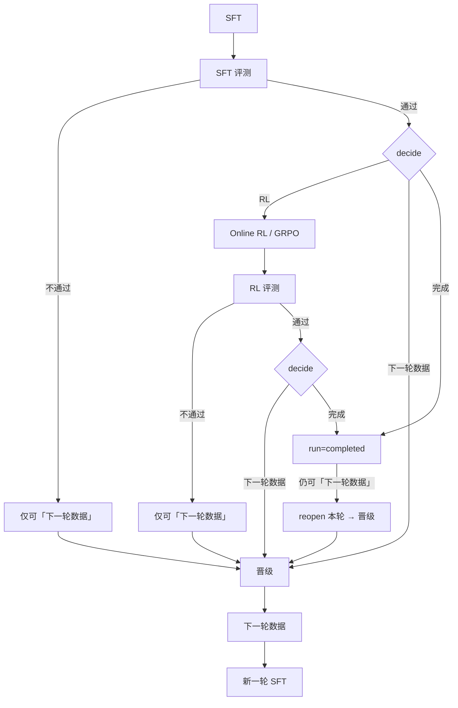

# RSI 多轮训练：SFT / RL 的 LoRA 与 checkpoint 如何传递

> 基于当前代码路径整理（`rsi/flow.py`、`rsi/pipeline.py`、`rsi/store.py`、`rsi/tests/test_adapter_checkpoint.py` 等）。  
> 相关总览见 [rsi/README.md](../../rsi/README.md)；评测对比见 [eval-base-compare.md](eval-base-compare.md)；导出见 [export-result.md](export-result.md)。

## 概述：多轮在 RSI 里指什么

一次 **实验（run）** 可包含多轮 **round**。每一轮是同一条主干：

**SFT → SFT 评测 →（可选）RL → RL 评测 → 决定「下一轮 / 完成」→ 若下一轮则「晋级」→「下一轮数据」→ 新一轮再从 SFT 开始。**

- **轮内**：评测是闸门；RL 可选；「完成」结束实验但仍可再开下一轮。
- **轮间**：只有显式 **晋级** 选出的那一个目录，会写入下一轮的 `rounds.base_model`，作为下一轮训练的「起点权重」。
- RSI **不会**自动 merge 多份 LoRA，也 **不会**把第 1、2 轮的 adapters 叠成 `--adapters a b`；下一轮最多带上 **一份** 晋级路径。

新建实验时锁定的 `run.base_model` / `model_type` / `template` 是实验身份；每轮的 `round.base_model` 才是「这一轮从哪份权重开训」。二者不要混为一谈。

## 一轮内典型路径



### 闸门与 decide（`rsi/flow.py`）

| 时机 | 可选动作 | 实现 |
|------|----------|------|
| SFT 评测通过 | RL / 下一轮数据 / 完成 | `decision_actions` |
| SFT 评测不通过 | 仅下一轮数据 | 同上；`stage_unlocked('rl')` 为假 |
| RL 评测通过 | 下一轮数据 / 完成 | 同上 |
| RL 评测不通过 | 仅下一轮数据 | 同上 |
| 已「完成」 | 仍可「下一轮数据」 | `decide` → `reopen_round` 后再晋级 |

- `decide`：`Pipeline.decide`（`rsi/pipeline.py`）→ 焦点切到 `rl` / `promote` / `finish`。
- 「下一轮数据」**先**进入 **晋级**，不是立刻开新轮。
- 「完成」：`Store.close_round` + `run.status=completed`；之后只有 `action=next` 可 `reopen_round`。

### 晋级与开启下一轮

1. **晋级**（`promote`）：从候选 `base` / `sft` / `rl` 选一个；`Store.set_promotion` 写入 `promoted_checkpoint` / `promoted_kind` / `promoted_score`。
2. **下一轮数据**（`next_round`）：`Store.close_round_and_open_next(..., next_base=promoted_checkpoint)`  
   - 关闭本轮；插入 `round_index+1`，其 **`base_model = 晋级路径`**；  
   - `run.round_index` 递增，`current_stage=sft`。

候选与推荐：`Pipeline.candidates`——有分数时按分数优先，同分偏好 `rl > sft > base`；无分数时有 RL 推 RL，否则 SFT，否则基座。

## SFT 多轮：checkpoint / LoRA 如何传递

### 判定 LoRA vs 全量

`_is_adapter_checkpoint`（`pipeline.py`）：

- 有 `adapter_config.json` → adapter；
- 否则若 **没有** `config.json` → 也当 adapter（含 mock）；
- 有 `config.json` 且无 adapter 文件 → **全量** checkpoint，走 `--model`，不写 `--adapters`。

下发命令前 `_place_trained_checkpoint` 会把「本应是 LoRA 的路径」从 `--model` 挪到 `--adapters`，并从该目录的 `args.json`（或链式上一份 adapter）解析真正的底座 `--model`（`_adapter_base_model`）。

### 逐步：第 1 → 2 → 3 轮（典型 LoRA）

假设实验底座为 `Qwen/...`，全程 LoRA、每轮都晋级 **本轮 SFT**。

| 轮次 | 开训时 `round.base_model` | 实际 `swift sft` 大致形态 | 产出 |
|------|---------------------------|---------------------------|------|
| 1 | 实验底座（hub / 本地全量） | `--model <底座>`（无上一轮 adapters） | LoRA 目录 **A**（如 `.../round_1/sft/.../checkpoint-*`） |
| 2 | 晋级后 = **A** | `--model <底座>` + `--adapters A` | 新目录 **B**（不是在 A 上原地 resume） |
| 3 | 晋级后 = **B** | `--model <底座>` + `--adapters B` | 新目录 **C** |

要点（有测试约定，见 `rsi/tests/test_adapter_checkpoint.py`）：

1. **下一轮是从「晋级的那一份 LoRA」继续训**，不是重新从裸底座无 adapter 开训（除非晋级选了 `base`）。
2. **只带最新晋级的那一份**：第 3 轮是 `--adapters B`，**不会**变成 `--adapters A B`，也 **不会**自动 stack / weighted merge。
3. **底座始终解析回原始全量模型**（`args.json` 里的 `model`，必要时沿 adapter 链往上走）；**不会**把上一轮 LoRA 目录当成 `--model`。
4. 新一轮有独立 `output_dir`（`stage_dir(run, round_n, 'sft')`），是 **新 checkpoint 目录**；RSI 不把上一轮 trainer 的 optimizer / 断点 `resume_from_checkpoint` 接过来，而是「用上一份 LoRA 初始化 adapters 再训一轮」。

若某轮产出的是 **全量** checkpoint（无 `adapter_config.json`、有 `config.json`），晋级后下一轮会把该目录当作 `--model`，不再填 `--adapters`（`test_full_checkpoint_stays_on_model`）。

### 晋级选 `base` 时

`candidates` 里的 `base` 路径是 **本轮** `rnd['base_model']`（可能已是更早轮晋级下来的 LoRA）。选 `base` 再 `next_round`，等于下一轮仍从这份起点开训，**丢弃本轮新训出的 SFT/RL 权重作为下一轮起点**（本轮 checkpoint 仍留在审计里）。

## RL 多轮：同上 + 与 SFT 的衔接

### 轮内：SFT → RL

同一轮内，RL 的默认权重来自 **本轮已成功的 SFT checkpoint**（`_defaults_for('rl')` → `active_checkpoint(..., 'sft')` → `_remember_checkpoint`）：

- SFT 是 LoRA → RL：`--model <底座>` + `--adapters <本轮 SFT>`；
- SFT 是全量 → RL：`--model <SFT 目录>`，无 adapters。

RL 评测则用 **本轮 RL checkpoint** 同样规则填表（`test_lora_checkpoint_is_passed_as_adapters`）。

**不能**在 SFT 评测未通过时进 RL（`stage_unlocked` / `blocked_message`）。

### 跨轮：上一轮 RL → 下一轮

RSI **没有**「新一轮直接从上一轮 RL 接着跑 RL、跳过 SFT」的路径。新轮 `current_stage` 固定回到 **SFT**。

跨轮接力的正确理解是：

1. 本轮晋级选 **`rl`** → `next_base = 本轮 RL LoRA（或全量）`；
2. 下一轮 **先做 SFT**：若晋级的是 LoRA，则 SFT 命令为 `--model <底座> --adapters <上一轮 RL>`；
3. 该轮 SFT 产出新 checkpoint 后，若再跑 RL，RL 又从 **这一轮新的 SFT** 接 adapters（不是直接挂上一轮 RL，除非你本轮 SFT 几乎没改、或你手动改表单）。

因此：

- **跨轮 RL 权重**：先作为下一轮 SFT 的 adapters 起点，而不是下一轮 RL 的直接输入；
- **轮内 RL**：始终默认接 **本轮 SFT**；
- 若希望「RL→RL」语义，实践上是：晋级 RL → 下一轮 SFT（可沿用数据、短训或按需调参）→ 再 RL。

### 示意：一轮内 SFT+RL，再晋级 RL 开第 2 轮

```text
Round 1:  base ──SFT──► A ──RL──► R1
晋级 choice=rl, next_round
Round 2:  round.base_model=R1
          SFT: --model base --adapters R1 ──► B
          RL:  --model base --adapters B  ──► R2
```

## 数据与配置如何晋级

| 项目 | 行为 | 入口 |
|------|------|------|
| 数据集 | `next_round` 默认 `reuse_dataset=true`；为真时把上一轮成功 SFT 的 `source` / `bundled` / `dataset` / `max_length` / `split_dataset_ratio` / `padding_free` 拷到本轮 SFT 默认 | `_carry_dataset` |
| 取消沿用 | 勾掉「沿用上一轮数据」则不拷贝 | `next_round` 表单 |
| 模型身份 | `model` / `model_type` / `template` 以实验锁定为准；表单草稿不覆盖身份 | `_lock_model_fields`、`_clean_draft` |
| 阶段草稿 | 按 **实验 + 轮次 + 阶段**  sticky；刷新后还在 | `save_draft` / `_form_state` |
| 本地路径改写 | hope/local 下 hub id → 本地目录；adapter 时底座也走同一套 | `_rewrite_model` + `_place_trained_checkpoint` |
| 工作台筛数据 | `pack_next_round` 把高分样本写成 `kept.jsonl`，需人工填回 SFT「服务器本地路径」 | `rsi/workbench.py`（**不是**自动晋级） |

`--model` / `--model_type` / `--template` 在新建实验后锁定；RL 与评测同样遵守（README 与 `_lock_model_fields`）。

## 常见误解 / 当前限制

1. **「第 3 轮会叠上第 1+2 轮两个 LoRA」** — 不会；只带晋级的那一个路径。
2. **「下一轮 SFT 是 trainer resume（优化器状态接着跑）」** — 不是；新 `output_dir`，用上一份权重作 adapters / model 初始化。
3. **「晋级 RL 后下一轮直接从 RL 阶段开始」** — 不会；一律回到 SFT。
4. **「`round.base_model` 等于实验 hub id」** — 第 2 轮起常常是 **checkpoint 目录**；真正发给 swift 的底座由 `_place_trained_checkpoint` 解析。
5. **「选完成就不能再开下一轮」** — 可以；完成后再点「下一轮数据」会 `reopen` 本轮再晋级。
6. **自动 merge** — 轮间不 merge；需要合并时用「模型导出」`swift export --merge_lora`（见 [export-result.md](export-result.md)）。
7. **手动改 adapters** — 预览/运行前仍可改表单；默认填充逻辑如上，以最终提交的 params 为准。

## 相关代码入口（简短）

| 关注点 | 位置 |
|--------|------|
| 流程图 / 闸门 / decide 按钮 | `rsi/flow.py`：`decision_actions`、`assemble_flow`、`stage_unlocked` |
| decide / reopen | `rsi/pipeline.py`：`Pipeline.decide`；`rsi/store.py`：`reopen_round` |
| 晋级候选 | `Pipeline.candidates` |
| 默认填表（含 adapters） | `Pipeline._defaults_for`、`_remember_checkpoint`、`_show_round_model` |
| LoRA ↔ model 改写 | `_place_trained_checkpoint`、`_is_adapter_checkpoint`、`_adapter_base_model` |
| 关轮开下轮 | `Store.close_round_and_open_next`；执行结果在 `_execute` 的 `next_round` 分支 |
| 沿用数据集 | `_carry_dataset` |
| 契约测试 | `rsi/tests/test_adapter_checkpoint.py`、`rsi/tests/test_flow.py` |

---

*文档日期：2026-10-22。若实现变更，以 `rsi/pipeline.py` / 上述测试为准。*
