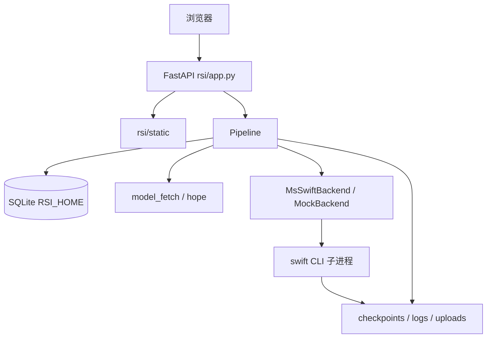
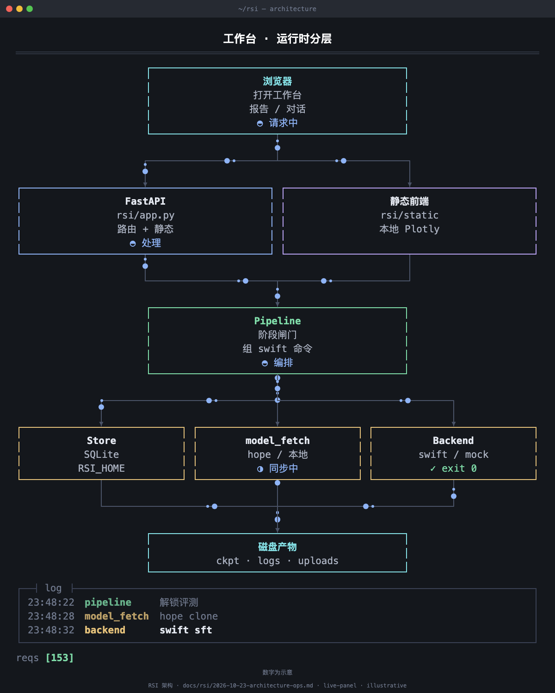

# RSI 架构与部署运维（内部）

面向维护「大模型微调工作台」的同学：代码怎么分层、进程怎么起停、状态落在哪、内网模型/数据怎么拉、出问题怎么查。用户操作说明见 [2026-10-23-user-guide.md](2026-10-23-user-guide.md)。开发者英文总览仍以 [`rsi/README.md`](../../rsi/README.md) 为准；本文用中文补齐部署运维视角。

产品对外名称：**大模型微调工作台**。代码与进程仍称 **RSI**（Recursive Self-Improvement 闭环 UI）。

---

## 1. 系统定位

RSI 是挂在 **本仓库 ms-swift 检出** 上的一层 Web 应用：

- **不修改** ms-swift 训练核心逻辑；训练 / 评测 / RL / 部署 / 导出通过子进程调用 `python -m swift.cli.main`（或 `RSI_SWIFT_BIN`）。
- UI 参数名与 Gradio Web-UI / CLI 对齐，便于对照文档与命令行。
- 默认监听 `0.0.0.0:8418`；同进程可挂载原版 Gradio Web-UI 于 `/swift-ui/`（工作台页头不放入口，运维仍可直接访问）。



**动态示意**（浏览器打开可循环播放；GitHub 上 HTML 内嵌通常无效，请本地下载后打开）：

[打开 live-panel HTML](assets/live-panel/architecture/architecture.html) · [mp4](assets/live-panel/architecture/architecture.mp4)



---

## 2. 代码与职责

| 路径 | 职责 |
|------|------|
| `rsi/app.py` | FastAPI 路由、静态页、健康检查、报告 HTML 出口 |
| `rsi/__main__.py` | `python -m rsi`：绑定 host/port、挂载 `/swift-ui`、uvicorn |
| `rsi/pipeline.py` | 阶段顺序、解锁、decide / promote、组命令、读评测产物 |
| `rsi/flow.py` | 闸门文案、流程图节点、通过阈值（默认 accuracy≥0.5） |
| `rsi/backends.py` | `MsSwiftBackend`（真跑）、`MockBackend`（点通 / 单测） |
| `rsi/store.py` | SQLite：`runs` / `rounds` / `steps` / `checkpoints` / `services` |
| `rsi/schemas.py` | 表单字段与 Web-UI 布局（`/api/schema`） |
| `rsi/model_fetch.py` | `RSI_HOME`、hope/hf/modelscope/local 拉取、启动描述 |
| `rsi/eval_report.py` | 读 evalscope 报告分数；**服务端整理后再返回 HTML** |
| `rsi/serving.py` | mock 侧 OpenAI 兼容服务 |
| `rsi/commands.py` | 拼装 `swift sft` / `eval` / `rlhf` / `deploy` / `export` |
| `rsi/gpu_options.py` | GPU 下拉与展示文案 |
| `rsi/dataset_*.py` | 校验、压缩包解压与路径改写 |
| `rsi/webui_*.py` | 与 Gradio 目录/字段对齐的元数据 |
| `rsi/static/` | 工作台前端；含本地 `plotly-*.min.js` |
| `rsi/configs/fetch.yaml` | 内网默认：模型源、conda、路径 |
| `rsi/configs/a100_80g.yaml` | 单卡 A100 表单默认值 |
| `rsi/examples/` | 内置 IT 样例数据与 GRPO reward 插件 |
| `rsi/scripts/sync-to-sankuai.sh` | GitHub ↔ 内网 git 同步分支 |
| `run.sh` | 启停重启、选解释器、hope 检查、写 `rsi/.rsi.log` |

测试：`pytest rsi/tests -q`（默认 mock，不加载权重）。

---

## 3. 运行时数据面

### 3.1 `RSI_HOME`（实验工作区）

解析顺序（`resolve_rsi_home`）：

1. 环境变量 `RSI_HOME`
2. `fetch.yaml` 的 `rsi_home`（目录或其父目录可写时）
3. 回退 `rsi/workspace`（例如本机没有 dolphinfs）

典型布局：

```text
$RSI_HOME/
  rsi.sqlite              # 元数据；需要本地可写盘（NFS/dolphinfs 易踩 journal 坑）
  uploads/<uuid>/         # 上传与解压后的数据集
  runs/<run_id>/
    round_<n>/
      sft/                # 训练产出、swift.log
      sft_eval/eval_output/   # 评测；基座对比在 …/base/
      rl/
      rl_eval/eval_output/
      export/
      serve/deploy.log
```

### 3.2 模型与公开数据集目录

由 `fetch.yaml` / 环境变量指定：

| 配置键 | 环境变量 | 用途 |
|--------|----------|------|
| `model_root` | `RSI_MODEL_ROOT` | hope clone 模型工作根 |
| `data_root` | `RSI_DATA_ROOT` | hope clone 数据集工作根 |
| `model_source` | `RSI_MODEL_SOURCE` | `hope` / `hf` / `modelscope` / `local` |
| `conda_env` | `RSI_CONDA_ENV` | Linux `./run.sh` 激活的环境名 |
| `train_python` | `RSI_TRAIN_PYTHON` | 启动 RSI 与 swift 的解释器 |
| `hope_username` | `RSI_HOPE_USERNAME` | hope login / clone 用户名 |

Token **只**走 `RSI_HOPE_TOKEN`，不要写进 yaml。

hope 就绪判定看本地文件（模型 `config.json`；数据集有数据文件），不调 `hope list`。同步中阶段状态为 `syncing`，进度写入该阶段 `swift.log` 与进程日志指针。

### 3.3 日志两层

| 日志 | 路径 | 内容 |
|------|------|------|
| 进程日志 | `rsi/.rsi.log` | 启动、hope login/clone（脱敏）、各阶段日志指针 |
| 阶段日志 | `$RSI_HOME/runs/.../swift.log` 等 | 训练 / 评测 / 拉取详细输出 |
| 部署日志 | `.../serve/deploy.log` | `swift deploy` |

PID：`rsi/.rsi.pid`。每次 `start` 成功会重建进程日志文件。

---

## 4. 主链路（与代码对应）

一轮：`sft` → `sft_eval` →（可选）`rl` → `rl_eval` → `decide` → `promote` 或 `finish`。

- 解锁：`flow.stage_unlocked`  
- 决定条：`flow.decision_actions` / `Pipeline.decide`  
- 开启下一轮：一次 `promote` 写入晋级 checkpoint 并 `close_round_and_open_next`  
- LoRA 跨轮：**只带一份**晋级 adapters，底座仍解析回全量 `--model`（见 [2026-10-22-multi-round-sft-rl.md](2026-10-22-multi-round-sft-rl.md)）

旁路：`serve`（部署+对话）、`export`（swift export）、评测报告 HTML（`read_report_html` 出口整理）。

---

## 5. HTTP 面（运维常看）

| 方法 | 路径 | 说明 |
|------|------|------|
| GET | `/` | 工作台静态页 |
| GET | `/api/health` | 探活 |
| GET | `/api/schema` | 表单与布局（有进程内缓存；改 schema 需重启） |
| GET/POST | `/api/runs`… | 实验 CRUD、阶段 run/stop/preview、decide、草稿 |
| GET | `/api/runs/{id}/stages/{stage}/report` | 评测 HTML（整理后返回） |
| GET | `/api/runs/{id}/eval-reports` | 对比选择器用的报告列表 |
| POST | `/api/runs/{id}/serve`… | 部署 / 停服 / chat / 日志 |
| POST | `/api/runs/{id}/export/...` | 导出预览 / 运行 / 停止 / 日志 |
| GET | `/static/...` | 前端与本地 Plotly |
| * | `/swift-ui/` | Gradio Web-UI（导入失败则错误页） |

---

## 6. 部署与启停

### 6.1 本机 / 训练机（推荐）

仓库根目录：

```bash
# 依赖（精简 UI 或完整训练环境按机器准备）
pip install -r rsi/requirements.txt
# GPU 训练机通常已有 conda env model-train，且 pip install -e . 装过 ms-swift

./run.sh          # 等同 restart
./run.sh start
./run.sh stop
./run.sh restart
```

- 默认：`http://127.0.0.1:8418/`（监听 `0.0.0.0:8418`）。  
- 覆盖：`RSI_PORT` / `WEBUI_PORT`，`RSI_HOST` / `WEBUI_SERVER`。  
- Linux：优先 `fetch.yaml` 的 `train_python` + `conda activate`；macOS：`rsi/.venv`。  
- 前台调试：`python -m rsi`。

### 6.2 后端模式

| 变量 | 含义 |
|------|------|
| `RSI_BACKEND` | `swift`（默认）或 `mock` |
| `RSI_SERVE_BACKEND` | 默认跟 `RSI_BACKEND`；测部署可用 mock |
| `RSI_SWIFT_BIN` | 整段替换 swift 启动命令 |
| `CUDA_VISIBLE_DEVICES` | 默认常为 `0` |

无 GPU 点通或跑 pytest：设 `RSI_BACKEND=mock`。

### 6.3 hope（内网）

- `fetch.yaml` 默认 `model_source: hope`。  
- Linux 缺 `hope` CLI 时 `./run.sh` **直接失败**并打印安装提示；macOS 默认跳过检查。  
- `RSI_SKIP_HOPE=1` 跳过；`RSI_REQUIRE_HOPE=1` 强制。  
- 真正 clone 前才 `hope login`（大象确认）；成功前阶段保持同步中。  
- 建议版本：hope `3.6.6`。

### 6.4 代码同步（GitHub ↔ 内网）

分支名以脚本内常量为准（当前：`cursor/rsi-diag-card-ui-20261019-4ed3`）：

```bash
rsi/scripts/sync-to-sankuai.sh
# 确认覆盖内网非快进时：
rsi/scripts/sync-to-sankuai.sh --force-sankuai
```

工作区有未提交改动会拒绝执行。细节见脚本头注释与 `rsi/README.md`「内网部署」。

### 6.5 改完配置 / 静态资源

| 变更 | 动作 |
|------|------|
| `rsi/static/*`、`rsi/*.py` | `./run.sh restart`，浏览器强刷 |
| `fetch.yaml` 路径 / 源 | 重启；必要时清错误缓存目录后「重新拉取」 |
| `/api/schema` 布局 | **必须重启**进程（schema 有缓存） |

---

## 7. 硬件预设（运维沟通用）

`rsi/configs/a100_80g.yaml` 面向 **1× A100 80GB**：

- 7B：LoRA + bf16；避免全量微调。  
- GRPO：vLLM **colocate**（单卡共享）；调低 `num_generations` / completion 长度可减压。  
- 14B：可试 QLoRA；32B 在线 RL 单卡不现实。  
- 单卡不启用 DeepSpeed/DDP/序列并行 UI。

具体数字以 yaml 与表单默认为准。

---

## 8. 排障手册

| 现象 | 排查 |
|------|------|
| 端口起不来 | `rsi/.rsi.log`；`./run.sh stop` 后再 start；查占用 `8418` |
| SQLite 写失败 | 错误里带库路径；把 `RSI_HOME` 指到本地可写盘，勿用只读 NFS 当库目录 |
| hope 登录超时 | 大象确认；点「重新拉取」；查 `RSI_HOPE_USERNAME` / token；看 `.rsi.log` |
| 同步中卡住 | 阶段 `swift.log` 是否有 clone 进度；磁盘配额；目录权限 |
| `/swift-ui/` 打不开 | 当前解释器缺 Gradio；按错误页提示在 `train_python` 安装 |
| 评测报告空白图 | 确认 `rsi/static/plotly-*.min.js` 已部署；报告应引用 `/static/plotly-…` |
| `swift eval` 非 0 但有报告 | 设计如此：有可用 `report.html`/分数时可记成功（见 eval-base-compare） |
| 训练 OOM | 降 batch / 长度 / vLLM 占用；确认未误开全量微调 |
| 阶段停不掉 | 「停止」只在 running；syncing 无停止按钮；极端情况查子进程组 |

健康检查：`curl -sS http://127.0.0.1:8418/api/health`。

---

## 9. 安全与凭据

- 勿把 `RSI_HOPE_TOKEN`、密钥写入仓库或 `fetch.yaml`。  
- 进程日志会对 hope 命令中的用户名/token 脱敏；仍避免把完整 `.rsi.log` 外传。  
- 服务默认 `0.0.0.0`：内网机器注意防火墙；仅本机可改 `RSI_HOST=127.0.0.1`。

---

## 10. 文档索引

| 文档 | 用途 |
|------|------|
| [2026-10-23-user-guide.md](2026-10-23-user-guide.md) | 用户操作手册 / 功能地图 |
| [2026-10-22-multi-round-sft-rl.md](2026-10-22-multi-round-sft-rl.md) | 多轮权重传递 |
| [eval-base-compare.md](eval-base-compare.md) | 基座与灵活对比 |
| [export-result.md](export-result.md) | 导出结果 UX |
| [dataset-archive-upload.md](dataset-archive-upload.md) | 压缩包上传 |
| [rl-grpo-speedup.md](rl-grpo-speedup.md) | GRPO 加速笔记 |
| [api-schema-performance.md](api-schema-performance.md) | schema 性能 |
| [`rsi/README.md`](../../rsi/README.md) | 模块总览与英文路径说明 |
