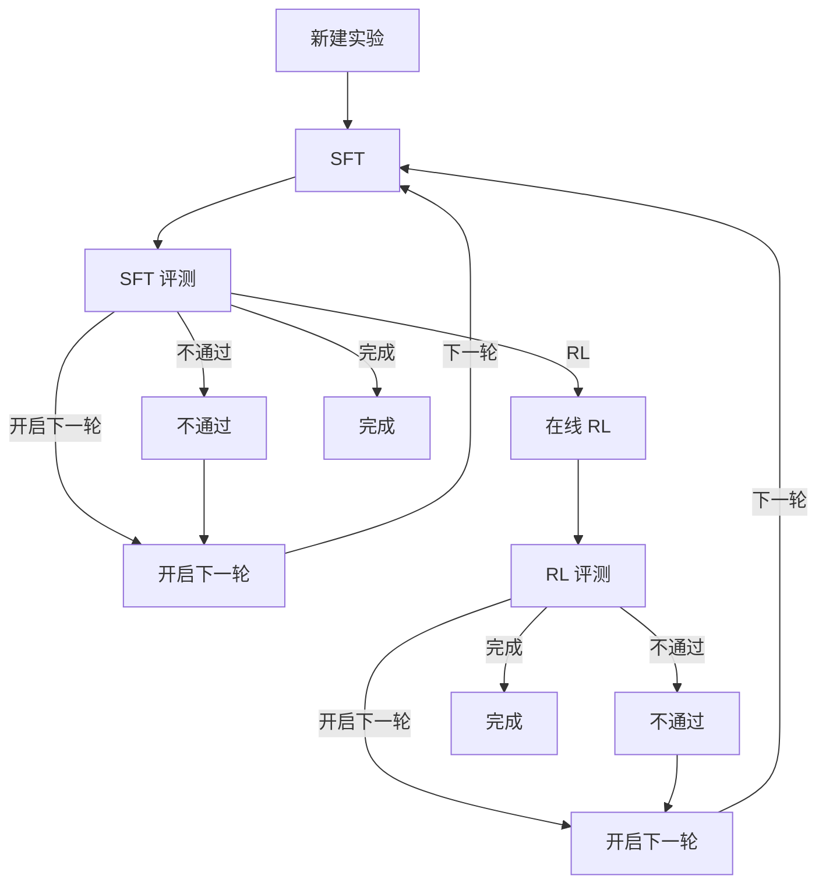
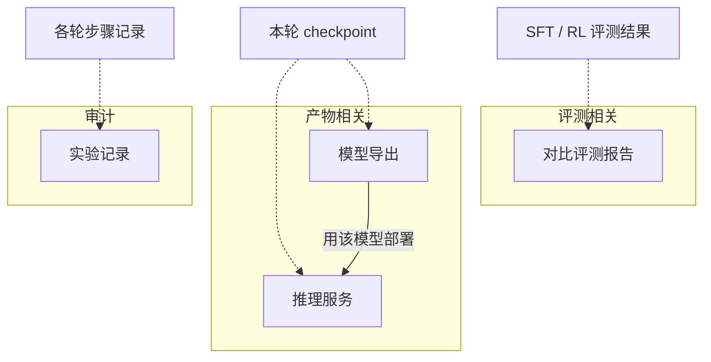

# 大模型微调工作台 · 功能地图与操作手册

打开页面后看到的产品名是 **大模型微调工作台**。

当前平台地址（仅部署在该 GPU 机）：[http://10.164.162.4:8418/](http://10.164.162.4:8418/)

---

## 1. 功能地图

### 1.1 实验主链路



### 1.2 旁路能力

与主链路并行，有可用 checkpoint / 评测结果后即可使用，不替代闸门决定。



| 能力 | 入口 | 说明 |
|------|----------------------|--------|
| 新建 / 管理实验 | 左侧列表、「新建实验」 | 一次实验 = 选定底座模型 + 场景说明，可多轮迭代 |
| SFT | 「流程」→ SFT | 监督微调，本轮产出 checkpoint / LoRA |
| SFT 评测 | 「流程」→ SFT 评测 | 留出集闸门；通过后才能进 RL |
| 在线 RL | 评测通过后点「RL」 | 默认 GRPO；用本轮 SFT 权重接着训 |
| RL 评测 | 「流程」→ RL 评测 | 对 RL 产出再评一次 |
| 开启下一轮 | 评测后「开启下一轮」 | 从候选权重里选一个作为下一轮起点，回到 SFT |
| 完成 | 评测通过后「完成」 | 标记实验结束；仍可再开下一轮 |
| 同时评测基座 | 评测表单勾选 | 同一次评测里多跑一趟无 adapter 的底座，方便对照 |
| 对比评测报告 | 结果区「对比」 | 跨轮次 / 历史重跑挑选多份报告做指标表 |
| 推理服务 | 顶栏「推理服务」 | 部署 OpenAI 兼容服务并在页内对话 |
| 模型导出 | 顶栏「模型导出」 | 合并 / 导出权重；成功后可一键去部署 |
| 实验记录 | 顶栏「实验记录」 | 审计每轮每步的状态、命令、日志入口 |

更细的技术约定（多轮 LoRA 怎么传、评测对比字段等）见同目录其它文档；日常操作以本文为准。

---

## 2. 推荐操作路径

1. **新建实验**  
   - 填名称、场景说明。  
   - 选择底座模型（如 `Qwen/Qwen2.5-7B-Instruct`）；`model_type` / `template` 会按模型带好，创建后锁定。  
   - 创建后自动进入 **第 1 轮 · SFT**。

2. **配数据并跑 SFT**  
   - 在 SFT 表单「数据集设置」里选来源：公开数据集 / 上传文件 / 服务器本地路径。  
   - 必须选好数据集后再点「运行本阶段」。  
   - 可选：先「校验格式」。  
   - 训练中看本阶段日志；需要时可点红色「停止」（仅运行中显示）。

3. **SFT 评测**  
   - SFT 成功后解锁。按表单选评测集与条数，点运行。  
   - 需要和底座比分时，勾选 **同时评测基座**。  
   - 结束后可打开完整 HTML 报告，或点「对比」挑选多份报告。

4. **按闸门做决定**  
   - **通过**：可选「RL」「开启下一轮」「完成」。  
   - **不通过**：只能「开启下一轮」（换权重或数据再训）。  
   - 进 **RL** 前必须 SFT 评测通过。

5. **RL → RL 评测**  
   - 默认沿用本轮 SFT 训练集与权重。  
   - 评测通过后：开启下一轮或完成；不通过：只能开启下一轮。

6. **开启下一轮**  
   - 在候选里选：**实验底座 / 本轮起点**、**本轮 SFT**、**本轮 RL**（有分数时会推荐更优的一侧）。  
   - 可选是否沿用上一轮数据集。  
   - 确认后进入新一轮 SFT；旧轮次仍在实验记录里。

7. **推理 / 导出**  
   - 有可用 checkpoint 即可去「推理服务」或「模型导出」。  
   - 导出成功后可用「用该模型部署推理」跳到推理页并预填合并后的模型路径。

---

## 3. 界面结构

| 区域 | 作用 |
|------|------|
| 左侧实验列表 | 切换实验；删除需确认 |
| 顶栏 Tab | **流程** / **实验记录** / **推理服务** / **模型导出** |
| 流程 · 轮次条 | 切换第 N 轮；可看历史轮 |
| 流程 · 示意图 | 本轮走到哪一步；未到达为灰、可达/已走高亮 |
| 流程 · 阶段表单 | 当前阶段参数、运行 / 停止、日志、结果与报告入口 |
| 决定条 | 评测结束后出现的「RL / 开启下一轮 / 完成」 |

表单改动会按「实验 + 轮次 + 阶段」自动存草稿，刷新后仍在；不必先点运行。

---

## 4. 各阶段怎么用

### 4.1 新建实验

- **实验名称**：列表里显示的名字。  
- **场景说明**：给人看的业务描述，不参与训练命令。  
- **底座模型**：决定本实验的 `--model` / `--model_type` / `--template`，创建后不可改。  
- 列表里可删除实验：会清掉该实验下的轮次、阶段产物；**已上传的数据文件会保留**。

### 4.2 SFT

- 参数布局对齐常见微调页：LoRA、精度、学习率、batch、最大长度等。  
- **数据集设置**  
  - **公开数据集**：从平台提供的列表选择（可多选）。内网环境首次使用可能先「同步中」拉取到本地，完成后再自动开训。  
  - **上传文件**：支持 jsonl 等文本；也支持 zip / tar / tar.gz（含相对路径的图片等多模态字段时，服务端会解压并改写为绝对路径）。  
  - **服务器本地路径**：填机器上已有路径（如示例 `rsi/examples/itops_mix.jsonl`）。  
- 单卡时一般不展示 DeepSpeed / DDP / 序列并行；多卡被选中后才会出现。  
- **更多参数**：YAML/键值追加，会覆盖同名表单字段。  
- **重跑**：若本阶段已成功，再跑会要求确认；旧记录保留为历史，本轮后续阶段会作废。

### 4.3 SFT 评测 / RL 评测

- 默认评测数据为工作台内置留出题（与训练混集分开）。  
- **同时评测基座**：见 [eval-base-compare.md](eval-base-compare.md)。  
- 结果区常见内容：指标摘要、基座对比表、打开报告、对比。  
- 完整报告在浏览器打开；图表脚本由工作台本地静态资源提供，一般不依赖外网 CDN。

### 4.4 RL

- 仅当 SFT 评测 **通过** 时解锁。  
- 默认使用本轮 SFT checkpoint（LoRA 走 adapters）。  
- 奖励与生成相关参数以表单为准；高级项可进更多参数。  
- 运行中同样可用「停止」。

### 4.5 开启下一轮

- 三选一权重起点，**不会**把多轮 LoRA 自动叠成多份 `--adapters`；下一轮只带你选中的那一份。  
- 成功后本轮的「RL / 开启下一轮 / 完成」条会收起；可用「前往第 N 轮」或「再次开启下一轮」。  
- 已点「完成」的实验仍可再开下一轮（从既有 checkpoint 继续迭代）。

### 4.6 推理服务

- 字段与常见「LLM 推理」页一致；模型 / 类型 / 模板 / adapters 按本轮实验预填并锁定（导出合并模型另说）。  
- **部署模型** 后可在页内流式对话。  
- **运行中部署 / 找回部署**：查看本实验正在跑的服务。  
- **停止推理**：停掉当前部署（会中断对话）。  
- 日志在服务运行时自动刷新。

### 4.7 模型导出

- 预览命令 → 开始导出 → 运行时看日志。  
- 导出结束后，「模型导出 → 运行时」会保留**最近一次导出**状态卡：
  - 成功 / 失败徽章、exit code、结束时间
  - `output_dir`（合并或量化产物路径）
  - 失败时附带日志末尾错误片段
  - 本轮最近若干次导出记录（路径 + 时间 + 状态）
- 成功后可点**用该模型部署推理**：跳到「推理服务」，把 `--model` 预填为该 `output_dir`，并清空 `--adapters`（已是完整权重，无需 LoRA）。再点页面上的部署按钮即可。

### 4.8 实验记录

- 按轮次列出阶段步骤：状态、起止时间、命令摘要。  
- 可回到对应阶段看日志；含被重跑作废的历史步。

---

## 5. 数据格式

SFT / RL 的「数据集设置」支持三种来源：

| 来源 | 用法 |
|------|------|
| 公开数据集 | 从平台列表选 id（可多选）。内网首次使用可能先「同步中」拉到本地，再自动开训。 |
| 上传文件 | 浏览器上传；支持文本与压缩包，见下文。 |
| 服务器本地路径 | 填 GPU 机上已有绝对路径（如仓库内 `rsi/examples/itops_mix.jsonl`）。 |

上传 / 本地文件在点「校验格式」或「运行本阶段」时，按 ms-swift 可接受的对话形状检查。上传体积不设上限。

### 5.1 支持的文件类型

- 文本：`.jsonl`（推荐，一行一条样本）、`.json`（单个对象或对象数组）、`.txt`（按 jsonl 行解析）
- 压缩包：`.zip`、`.tar`、`.tar.gz`、`.tgz`（含图片等多模态时用；见 5.4）

### 5.2 四种样本形状

每条样本必须是一个 JSON 对象。推荐优先用 **messages**。

**messages（标准多轮）**

`role` 可为 `system` / `user` / `assistant` / `tool` / `tool_call`；一般要有 `content`（assistant 也可只有 `tool_calls`）。SFT 通常需要至少一条带内容的 `assistant`。

```json
{"messages":[{"role":"system","content":"你是企业内部 IT 运维助手。"},{"role":"user","content":"VPN 一直停在正在连接"},{"role":"assistant","content":"判断：……\n步骤：1. ……"}]}
```

**ShareGPT**

```json
{"conversation":[{"human":"用户问题","assistant":"模型回答"}]}
```

**Alpaca**

```json
{"instruction":"任务说明","output":"期望回答"}
```

也可用 `response` 代替 `output`。

**query / response**

```json
{"query":"用户问题","response":"期望回答"}
```

### 5.3 GRPO 用的 solution / answer

做在线 RL（GRPO）时，可在样本上保留 `solution` 或 `answer`，供奖励函数对照。允许只有 user、没有 assistant 的 messages，但此时必须带 `solution` 或 `answer`，否则校验会当成「仅有 prompt」并告警。

```json
{"messages":[{"role":"user","content":"工单：……"}],"solution":"关键要点|关键词"}
```

平台示例：`rsi/examples/itops_mix.jsonl`（训练）、`rsi/examples/itops_eval.jsonl`（留出评测）、`rsi/examples/itops_reward.py`（GRPO 奖励插件）。

### 5.4 多模态与压缩包

文本里用相对路径引用图片 / 视频 / 音频时，请打成压缩包上传。推荐结构：

```text
my_dataset.zip
├── data.jsonl          # 或 train.jsonl；多个 jsonl 时优先这两个名字，否则取体积最大的
└── images/
    └── a.jpg
```

jsonl 示例：

```json
{"messages":[{"role":"user","content":"<image>描述图片"},{"role":"assistant","content":"..."}],"images":["images/a.jpg"]}
```

- 媒体字段：`images` / `videos` / `audios`，或单数 `image` / `video` / `audio`；值为字符串、字符串列表，或嵌套列表（如视频帧）。
- 消息里的 `<image>` 等占位符保持不动。
- 已是绝对路径，或 `http://` / `https://` / `data:` URI，**不会**被改写。
- 服务端会把相对路径改成解压目录下的绝对路径，再交给训练；产物在工作区 `uploads/<uuid>/`。
- 若改写后文件不存在，校验会带警告，但不会仅因此失败。
- 解压会拒绝路径穿越（`../`）、绝对路径成员、以及指向解压目录外的符号链接。

### 5.5 校验与常见失败

1. 在 SFT 表单点「校验格式」，看行数、识别到的格式、错误行号。  
2. 常见错误：不是 JSON 对象、`messages` 为空、`role` 非法、ShareGPT 缺 `human`/`assistant`、四种形状都不匹配。  
3. 全部样本都没有 assistant / solution 时会告警（只适合「仅 prompt」场景，一般 SFT 不够用）。  
4. 公开数据集不在本地校验行格式；由 ms-swift 在真跑时解析。  
5. 改完数据后重新上传或改路径，再校验一次再开训。

---

## 6. 状态与按钮含义

| 状态 | 含义 | 常见操作 |
|------|------|----------|
| 待运行 | 尚未成功跑过（或可再跑） | 运行本阶段 |
| 同步中 | 正在拉模型 / 公开数据集 | 看日志；一般不显示「停止」 |
| 运行中 | 训练 / 评测 / 导出进程在跑 | 「停止」结束并记为失败，可重试 |
| 成功 | 本步产出可用 | 进入下一解锁阶段或决定条 |
| 失败 | 进程非 0 或中途停止 | 改参后重跑 |
| 已作废 | 本轮前面步骤重跑导致后续失效 | 需按流程重新跑后续阶段 |

评测「通过 / 不通过」默认看准确率是否达到阈值（常见 0.5）；具体以当次结果展示为准。

---

## 7. 常见问题

**Q. 为什么点不了 RL？**  
A. SFT 评测必须先跑完且判定为通过。

**Q. 评测不通过还能干什么？**  
A. 只能「开启下一轮」：换起点权重或数据再训，不能直接进 RL / 完成。

**Q. 下一轮是接着训还是从头训？**  
A. 取决于你在「开启下一轮」里选的权重。选本轮 SFT/RL 时，下一轮 SFT 会从该 LoRA（或全量 checkpoint）继续；选底座/本轮起点则从该路径开训。详见 [2026-10-22-multi-round-sft-rl.md](2026-10-22-multi-round-sft-rl.md)。

**Q. 公开数据集一直「同步中」？**  
A. 内网首次拉取可能较久；看本阶段日志进度。已就绪的本地缓存不会重复拉。仍失败时联系运维检查模型/数据源登录与磁盘。

**Q. 训练很慢 / 显存不够？**  
A. 先减小 batch、序列长度、生成条数；单卡 7B 优先 LoRA，避免全量微调。硬件预设说明可问运维或看内部架构文档。

**Q. 误删实验？**  
A. 删除会清实验目录下产物，上传文件一般仍保留在工作区 uploads；无法从页面一键恢复实验记录。

---

## 8. 相关文档

| 文档 | 内容 |
|------|------|
| [2026-10-23-architecture-ops.md](2026-10-23-architecture-ops.md) | 架构、目录、环境变量、部署运维 |
| [2026-10-22-multi-round-sft-rl.md](2026-10-22-multi-round-sft-rl.md) | 多轮 SFT/RL 与 LoRA 传递 |
| [eval-base-compare.md](eval-base-compare.md) | 基座对比与灵活对比 |
| [rl-grpo-speedup.md](rl-grpo-speedup.md) | GRPO 加速相关 |
| [api-schema-performance.md](api-schema-performance.md) | Schema 接口性能 |

仓库总览与开发者说明：[`rsi/README.md`](../../rsi/README.md)。
