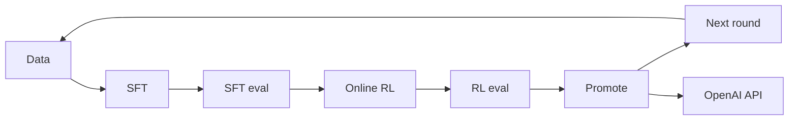

# RSI closed loop on ms-swift

Click-through recursive self-improvement on top of ms-swift:

**data → SFT → SFT eval → online RL → RL eval → promote → next round → OpenAI-compatible serve**

The UI speaks Chinese. Parameter names match the existing Gradio Web-UI and the `swift sft` / `swift rlhf` / `swift eval` / `swift deploy` CLIs. ms-swift itself is not modified; this app shells out to it only when you ask.

Default mode calls **this checkout's ms-swift** (`python -m swift.cli.main`) on GPU 0: `swift sft`, `swift eval`, `swift rlhf`, and `swift deploy`. The held-out IT jsonl is converted to an EvalScope `general_qa` folder before eval. Set `RSI_BACKEND=mock` when you want the deterministic click-through that does not load weights.



This is the manual version of the loop most post-training stacks use now: supervised fine-tuning sets the scenario behavior, a held-out eval is the gate, online RL (GRPO here, the default in ms-swift) pushes the policy with a reward, and only the winning checkpoint becomes the next base. InstructGPT used SFT → reward model → PPO. Open recipes more often skip the learned reward model and score completions directly (GRPO / RLOO / DAPO). The human stays on the gate: every stage is a form, and promotion is an explicit choice.

## Run locally (mock)

From the repository root:

```bash
pip install -r rsi/requirements.txt
./run.sh
```

`./run.sh` with no arguments restarts the UI. `./run.sh start`, `./run.sh stop`, and `./run.sh restart` do what they say. The process id is `rsi/.rsi.pid` and the log is `rsi/.rsi.log`. `python -m rsi` still works if you want the server in the foreground.

Open http://127.0.0.1:7860

Then:

1. **新建实验**. The default base is `Qwen/Qwen2.5-7B-Instruct` and the scenario is an internal IT helpdesk.
2. **数据**. Leave the bundled `itops_mix.jsonl` selected (ms-swift `messages` plus a `solution` field for GRPO). Click 校验格式, then 运行本阶段. You can also pick a public id such as `modelscope/gsm8k`, upload a jsonl, or type a local path.
3. **SFT**. The form is the A100 preset (`swift sft`, LoRA, bf16). Run it. The log shows the command that real training would execute, and a mock `checkpoint-final/args.json` is written.
4. **SFT 评测**, **在线 RL** (`swift rlhf --rlhf_type grpo`, vLLM colocate), **RL 评测**. Same pattern.
5. **晋级**. RL is recommended when its mock accuracy is higher. You can still pick SFT or stay on the base.
6. **下一轮**. The promoted checkpoint becomes the next base and the board returns to 数据. Previous rounds stay in the audit.
7. **推理服务**. Starts a real local HTTP server with `GET /v1/models` and `POST /v1/chat/completions`. Weights are not loaded. The page has a one-line chat box that calls that API.

Re-running an earlier stage keeps the old audit row and marks later stages in that round as 已作废.

Override the port with `WEBUI_PORT` or `RSI_PORT` (default `7860`) and the bind address with `WEBUI_SERVER` or `RSI_HOST`. State (SQLite, uploads, mock checkpoints) lives in `rsi/workspace/`, or in `$RSI_HOME`.

```bash
pytest rsi/tests -q
```

## Data format

Local files are checked against the shapes ms-swift's `AutoPreprocessor` accepts (see `docs/source_en/Customization/Custom-dataset.md`):

- `messages` with `role` / `content` (standard)
- sharegpt `conversation` of `human` / `assistant`
- alpaca `instruction` + `output`
- `query` + `response`

A `solution` or `answer` field is kept for GRPO, including rows that only have a user turn. Public dataset ids are recorded and not downloaded in mock mode; ms-swift resolves them when the real CLI runs. The sample files are:

- `rsi/examples/itops_mix.jsonl` — six IT tickets, messages + `solution`
- `rsi/examples/itops_eval.jsonl` — four held-out tickets
- `rsi/examples/itops_reward.py` — GRPO reward plugin (`itops_checklist`). Mock mode never imports it. Real `swift rlhf` loads it via `--external_plugins`.

## Backend

| Variable | Default | Without a GPU |
| --- | --- | --- |
| `RSI_BACKEND` | `swift` | `mock` |
| `RSI_SERVE_BACKEND` | same as `RSI_BACKEND` | `mock` to keep the in-process API |
| `RSI_SWIFT_BIN` | `python -m swift.cli.main` in this repo | a stub executable for tests |
| `CUDA_VISIBLE_DEVICES` | `0` | unused in mock mode |

`MsSwiftBackend` runs the recorded command with `subprocess` and marks the step failed if swift exits non-zero. Training steps return immediately in the UI and finish when the process exits; refresh the audit while a job is running. Serving with `RSI_SERVE_BACKEND=swift` launches `swift deploy` in the background. Mock serving is an in-process OpenAI-compatible server, which is what `pytest` talks to.

Install ms-swift and a GPU stack on the training machine the usual way (`pip install -e .` from this repo, plus the CUDA extras you need). This RSI app does not import `swift`, so the UI keeps working on a box that only has the packages in `rsi/requirements.txt`.

## Hardware this preset is for

1× NVIDIA A100 80GB, 18 CPU cores, about 92GB RAM with about 60GB usable.

The numbers in `rsi/configs/a100_80g.yaml` are the form defaults:

- **7B LoRA bf16** is the loop that fits SFT and GRPO together. SFT uses batch 1, gradient accumulation 16, max length 2048, gradient checkpointing, `attn_impl=sdpa` (switch to `flash_attention_2` if it is installed).
- **Do not full-finetune** a 7B on this box. Adam optimizer state does not fit in ~60GB usable RAM. Leave `tuner_type=lora`.
- **14B** can be tried as QLoRA (`quant_method=bnb`, `quant_bits=4`) for SFT. GRPO plus a colocated vLLM on 14B is tight; lower `max_completion_length` and `num_generations` first.
- **32B online RL does not fit** on one 80GB GPU.
- GRPO uses **vLLM colocate** so rollout and training share the only GPU: `vllm_gpu_memory_utilization=0.45`, `sleep_level=1`, `offload_model`, `offload_optimizer`, `num_generations=4`, tensor parallel 1. Server-mode vLLM would want a second GPU; this preset does not.
- `dataset_num_proc=8` and `dataloader_num_workers=4` leave cores for vLLM on an 18-core machine.
- Deploy after promotion uses `infer_backend=vllm` and can take most of the GPU (`vllm_gpu_memory_utilization=0.9`) because training is finished.

Any other swift flag can be added in the YAML box on each stage. Those keys are appended to the CLI and override the form.

## Audit

SQLite tables `runs`, `rounds`, `steps`, `checkpoints`, and `services` record each run and each step: status, params, result, logs, the swift command, `started_at`, and `ended_at`. The 审计 tab shows them, including superseded attempts. The database file is `$RSI_HOME/rsi.sqlite` (default `rsi/workspace/rsi.sqlite`).

## Layout

```
rsi/app.py            FastAPI + static UI
rsi/pipeline.py       stage order and promotion
rsi/backends.py       MockBackend, MsSwiftBackend
rsi/serving.py        mock OpenAI server
rsi/schemas.py        form fields copied from the Web-UI argument names
rsi/configs/a100_80g.yaml
rsi/examples/         bundled data and the GRPO reward plugin
rsi/tests/            dataset checks and the mock end-to-end loop
```
