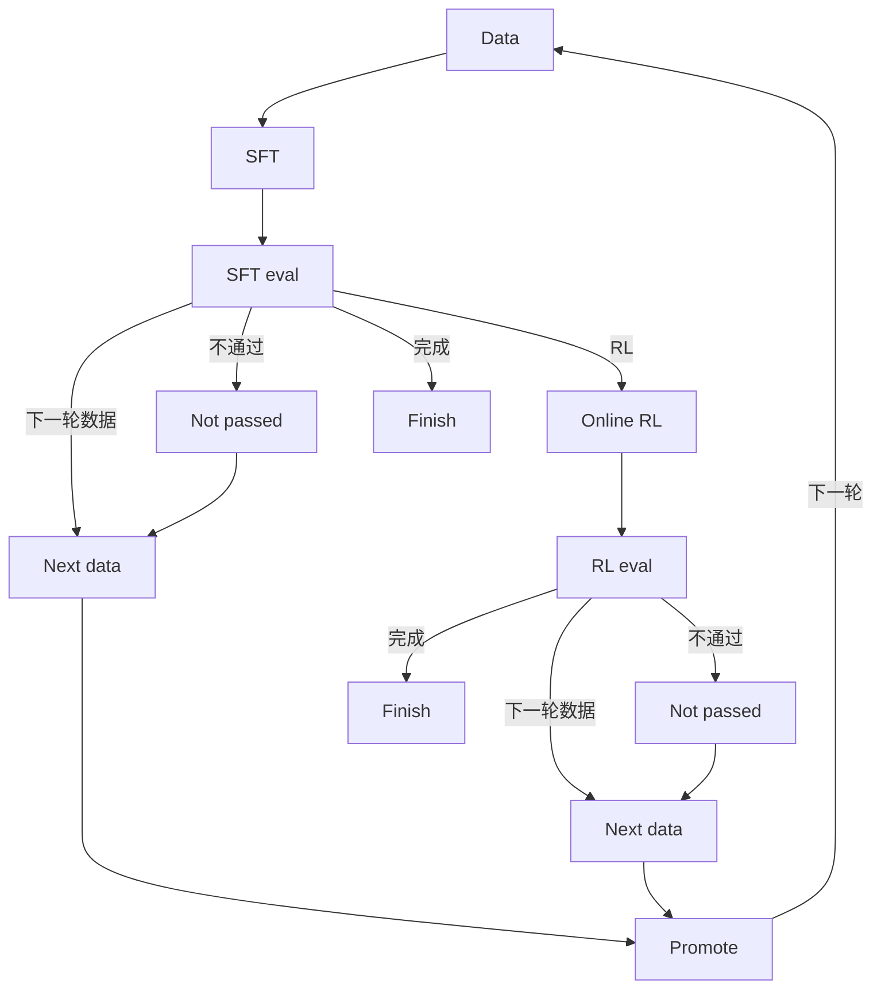

# RSI closed loop on ms-swift

Click-through recursive self-improvement on top of ms-swift:

**data → SFT → SFT eval**. A passed SFT eval can enter online RL, open the next round of data, or finish the run. A failed SFT eval can only open the next round of data. After RL eval, a pass can finish or open the next round; a failure only opens the next round. There is no separate stop action.

The UI speaks Chinese. Parameter names match the existing Gradio Web-UI and the `swift sft` / `swift rlhf` / `swift eval` / `swift deploy` CLIs. ms-swift itself is not modified; this app shells out to it only when you ask.

Default mode calls **this checkout's ms-swift** (`python -m swift.cli.main`) on GPU 0: `swift sft`, `swift eval`, `swift rlhf`, and `swift deploy`. The held-out IT jsonl is converted to an EvalScope `general_qa` folder before eval. Set `RSI_BACKEND=mock` when you want the deterministic click-through that does not load weights.



This is the manual version of the loop most post-training stacks use now: supervised fine-tuning sets the scenario behavior, a held-out eval is the gate, online RL (GRPO here, the default in ms-swift) pushes the policy with a reward, and only the winning checkpoint becomes the next base. InstructGPT used SFT → reward model → PPO. Open recipes more often skip the learned reward model and score completions directly (GRPO / RLOO / DAPO). The human stays on the gate: every stage is a form, and promotion is an explicit choice.

## Run locally (mock)

From the repository root:

```bash
pip install -r rsi/requirements.txt
./run.sh
```

`./run.sh` with no arguments restarts the UI. `./run.sh start`, `./run.sh stop`, and `./run.sh restart` do what they say. The process id is `rsi/.rsi.pid` and the log is `rsi/.rsi.log`. `python -m rsi` still works if you want the server in the foreground.

The server listens on `0.0.0.0:8418`. On this machine open http://127.0.0.1:8418

Then:

1. **新建实验**. The default base is `Qwen/Qwen2.5-7B-Instruct` and the scenario is an internal IT helpdesk.
2. **数据**. Leave the bundled `itops_mix.jsonl` selected (ms-swift `messages` plus a `solution` field for GRPO). Click 校验格式, then 运行本阶段. You can also pick a public id such as `modelscope/gsm8k`, upload a jsonl, or type a local path.
3. **SFT**. The form is the single-GPU preset (`swift sft`, LoRA, bf16). Run it. The log shows the command that real training would execute, and a mock `checkpoint-final/args.json` is written.
4. **SFT 评测**, **在线 RL** (`swift rlhf --rlhf_type grpo`, vLLM colocate), **RL 评测**. Same pattern.
5. **晋级**. RL is recommended when its mock accuracy is higher. You can still pick SFT or stay on the base.
6. **下一轮数据**. Choosing it opens 晋级 first. The promoted checkpoint becomes the next base and the board returns to 数据. Previous rounds stay in the audit.
7. **推理服务**. Starts a real local HTTP server with `GET /v1/models` and `POST /v1/chat/completions`. Weights are not loaded. The page has a one-line chat box that calls that API.

Re-running an earlier stage keeps the old audit row and marks later stages in that round as 已作废.

The default bind is `0.0.0.0:8418`. Override the port with `WEBUI_PORT` or `RSI_PORT`, and the bind address with `WEBUI_SERVER` or `RSI_HOST` (for example `127.0.0.1` to refuse other machines). The header chip **打开 SWIFT Web-UI** goes to `/swift-ui/` on this same process. When Gradio and the swift training stack import, that path is the original Web-UI. Otherwise the page says it cannot be opened. The standalone `swift web-ui` command uses the same default, `0.0.0.0:8418`. `WEBUI_PORT`, `WEBUI_SERVER`, `--server_port`, and `--server_name` still override it. State (SQLite, uploads, checkpoints) lives in `rsi/workspace/`, or in `$RSI_HOME`.

```bash
pytest rsi/tests -q
```

## Data format

Local files are checked against the shapes ms-swift's `AutoPreprocessor` accepts (see `docs/source_en/Customization/Custom-dataset.md`):

- `messages` with `role` / `content` (standard)
- sharegpt `conversation` of `human` / `assistant`
- alpaca `instruction` + `output`
- `query` + `response`

A `solution` or `answer` field is kept for GRPO, including rows that only have a user turn. Public dataset ids are recorded and not downloaded in mock mode; ms-swift resolves them when the real CLI runs. The sample files are:

- `rsi/examples/itops_mix.jsonl` — six IT tickets, messages + `solution`
- `rsi/examples/itops_eval.jsonl` — four held-out tickets
- `rsi/examples/itops_reward.py` — GRPO reward plugin (`itops_checklist`). Mock mode never imports it. Real `swift rlhf` loads it via `--external_plugins`.

## Backend

| Variable | Default | Without a GPU |
| --- | --- | --- |
| `RSI_BACKEND` | `swift` | `mock` |
| `RSI_SERVE_BACKEND` | same as `RSI_BACKEND` | `mock` to keep the in-process API |
| `RSI_SWIFT_BIN` | `python -m swift.cli.main` in this repo | a stub executable for tests |
| `CUDA_VISIBLE_DEVICES` | `0` | unused in mock mode |

`MsSwiftBackend` runs the recorded command with `subprocess` and marks the step failed if swift exits non-zero. Training steps return immediately in the UI and finish when the process exits; refresh the audit while a job is running. Serving with `RSI_SERVE_BACKEND=swift` launches `swift deploy` in the background. Mock serving is an in-process OpenAI-compatible server, which is what `pytest` talks to.

Install ms-swift and a GPU stack on the training machine the usual way (`pip install -e .` from this repo, plus the CUDA extras you need). This RSI app does not import `swift`, so the UI keeps working on a box that only has the packages in `rsi/requirements.txt`.

## 内网部署

`rsi/configs/fetch.yaml` 的 `model_source` 默认是 **hope**。拉取这份代码后不用再设环境变量：训练前会用 hope 把 Hugging Face 模型同步到本地，`--model` 用本地绝对路径。环境变量 `RSI_MODEL_SOURCE` 仍然优先。Mac 上如果要走 ModelScope，启动前设置 `RSI_MODEL_SOURCE=modelscope`。

hope 或 local 下，同步还是「同步中」时不会启动 swift。`modelscope/...` 这种 id 会提示不能在当前网络下载。

hope 模式下可以不装 modelscope 这个 pip 包：`swift/utils/logger.py` 在缺包时退回本地日志，`import swift` 不会因此失败。完整安装 `pip install -e .` 仍会装上 modelscope。

| 变量 | 作用 |
| --- | --- |
| `RSI_MODEL_SOURCE` | 覆盖 fetch.yaml。可选 `hope`（配置文件里的默认）、`hf`、`modelscope`、`local` |
| `RSI_MODEL_ROOT` | 模型目录，对应 `fetch.yaml` 的 `model_root`。`~` 和 `$HOME` 会展开。`hope clone` 的工作目录就是这一层，仓库落在 `<根>/<org>/<name>` |
| `RSI_DATA_ROOT` | 数据集目录，对应 `data_root`，同样展开 `~` / `$HOME`。`hope clone` 的工作目录是这一层 |
| `RSI_HOPE_USERNAME` / `RSI_HOPE_TOKEN` | 用户名同时用于 `hope login <misid>` 和 `hope clone --username=`。token 只作为 `hope clone` 的 git token（`--token=`），不是平台登录。token 不要写进 yaml |
| `RSI_FETCH_CONFIG` | 另选一份 yaml，键与 `fetch.yaml` 相同 |

`fetch.yaml` 示例：

```yaml
model_source: hope
hope_username: liyuhao03
model_root: ~/models
data_root: ~/datasets
```

仓库里的 `fetch.yaml` 就是这样写的。`~/models` 会展开成这台机器当前用户的家目录，例如 `/home/hadoop-sailorqa-ai/models`。拉取模型时先进入这个目录，再执行 `hope clone https://huggingface.co/<org>/<name>`。本地就绪路径是 `<model_root>/<org>/<name>`，里面有 `config.json` 才算就绪。数据集同样落在 `<data_root>/<org>/<name>`。

仓库里的 `fetch.yaml` 已写 `hope_username: liyuhao03`。这个 misid 会传给 `hope login`，也会作为 `hope clone` 的 `--username=`。换 misid 改这一行，或用 `RSI_HOPE_USERNAME` 覆盖。token 仍只走 `RSI_HOPE_TOKEN`，只给 `hope clone` 当 git 凭据，不能代替平台登录。

平台登录由 RSI 自己执行。启动时，以及每次 `hope clone` 之前，会跑 `hope login liyuhao03`（标准输入关闭，最多等约 90 秒）。hope 会往大象发确认；页面上显示「已向大象发送登录确认，请在大象里确认」。确认后 hope 打印「登录成功」，接着才会 clone。已经登录时这条命令大约 1 秒返回；同一次进程里随后的 clone 不再重复调用，除非这次 clone 又打出登录认证。同一时间只跑一次登录。失败或超时后几分钟内不会再次发给大象，点「重新拉取」可以马上再发一次。超时或未确认时，拉取状态是「hope 登录未确认：请点重新拉取再发一次，或在终端执行 hope login liyuhao03」。没有配置 misid 时会提示设置 `hope_username`。

hope 本身要事先装好（`./run.sh` 不会安装它）。来源是 hope 但找不到 `hope` 命令时，`./run.sh` 打印下面这一行并立刻以非 0 退出，不会把服务拉起来：

```text
pip3 install hope==3.6.6 --no-cache-dir -i https://pypi.sankuai.com/simple
```

进程日志是 `rsi/.rsi.log`。纯文本是 `http://<主机>:8418/api/server-log`（没有这个文件时是 404）。自动跟上新日志的页面是 `/server-log`。它先用 SSE `/api/server-log/events`；几秒内没有推送就改为定时拉取 `/api/server-log/stream`。`hope login` 会把命令、目录、退出码和输出写进这份日志。`hope clone` 一开始就写命令和目录，随后把 stdout/stderr 原样追加进同一个文件（不等进程结束，用户名和 token 会抹掉），结束时再写退出码。hope 的标准输入是关闭的，不会停在密码提示上。

`hope --version` 应为 3.6.6。同步是异步的。页面上的拉取状态只看本地文件：目录里出现 `config.json` 后才是「就绪」，在这之前是「同步中，进度见进程日志」。不会调用 `hope list`。训练命令的 `--model` 改为本地路径，并带上 `--model_type` 和 `--template`。子进程会设置 `HF_HUB_OFFLINE=1`、`TRANSFORMERS_OFFLINE=1`、`HF_DATASETS_OFFLINE=1`。

公开数据集请用 Hugging Face 的 `org/name`，或直接上传本地文件。`modelscope/...` 会提示不能在当前网络下载。内置评测 jsonl 仍走本地 `general_qa`。其它评测集放到 `$RSI_DATA_ROOT/benchmarks/<名字>`，或在 `eval_dataset_args` 里写 `local_path`。

## Hardware this preset is for

1× NVIDIA A100 80GB, 18 CPU cores, about 92GB RAM with about 60GB usable.

The numbers in `rsi/configs/a100_80g.yaml` are the form defaults:

- **7B LoRA bf16** is the loop that fits SFT and GRPO together. SFT uses batch 1, gradient accumulation 16, max length 2048, gradient checkpointing, `attn_impl=sdpa` (switch to `flash_attention_2` if it is installed).
- **Do not full-finetune** a 7B on this box. Adam optimizer state does not fit in ~60GB usable RAM. Leave `tuner_type=lora`.
- **14B** can be tried as QLoRA (`quant_method=bnb`, `quant_bits=4`) for SFT. GRPO plus a colocated vLLM on 14B is tight; lower `max_completion_length` and `num_generations` first.
- **32B online RL does not fit** on one 80GB GPU.
- GRPO uses **vLLM colocate** so rollout and training share the only GPU: `vllm_gpu_memory_utilization=0.45`, `sleep_level=1`, `offload_model`, `offload_optimizer`, `num_generations=4`, tensor parallel 1. Server-mode vLLM would want a second GPU; this preset does not.
- `dataset_num_proc=8` and `dataloader_num_workers=4` leave cores for vLLM on an 18-core machine.
- Deploy after promotion uses `infer_backend=vllm` and can take most of the GPU (`vllm_gpu_memory_utilization=0.9`) because training is finished.

Any other swift flag can be added in the YAML box on each stage. Those keys are appended to the CLI and override the form.

## Audit

SQLite tables `runs`, `rounds`, `steps`, `checkpoints`, and `services` record each run and each step: status, params, result, logs, the swift command, `started_at`, and `ended_at`. The 审计 tab shows them, including superseded attempts. The database file is `$RSI_HOME/rsi.sqlite` (default `rsi/workspace/rsi.sqlite`).

## Layout

```
rsi/app.py            FastAPI + static UI
rsi/pipeline.py       stage order and promotion
rsi/backends.py       MockBackend, MsSwiftBackend
rsi/model_fetch.py    optional local copy before swift runs
rsi/serving.py        mock OpenAI server
rsi/schemas.py        form fields copied from the Web-UI argument names
rsi/configs/a100_80g.yaml
rsi/examples/         bundled data and the GRPO reward plugin
rsi/tests/            dataset checks and the mock end-to-end loop
```
