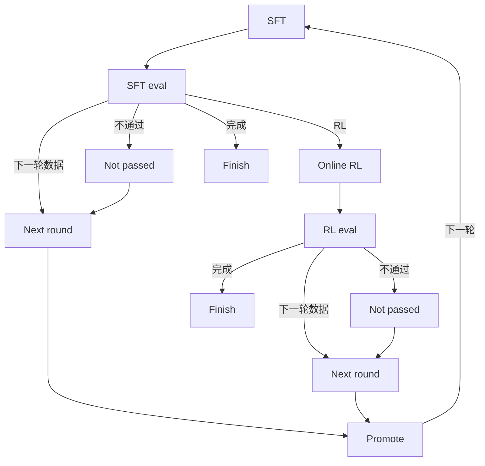

# RSI closed loop on ms-swift

Click-through recursive self-improvement on top of ms-swift:

**SFT → SFT eval**. Dataset settings live on SFT. A passed SFT eval can enter online RL, open the next round, or finish the run. A failed SFT eval can only open the next round. After RL eval, a pass can finish or open the next round; a failure only opens the next round. Finishing marks the experiment complete but does not lock「下一轮数据」: you can still promote and start another round from prior checkpoints. There is no separate stop action.

The UI speaks Chinese. Parameter names match the existing Gradio Web-UI and the `swift sft` / `swift rlhf` / `swift eval` / `swift deploy` CLIs. ms-swift itself is not modified; this app shells out to it only when you ask.

Default mode calls **this checkout's ms-swift** (`python -m swift.cli.main`) on GPU 0: `swift sft`, `swift eval`, `swift rlhf`, and `swift deploy`. The held-out IT jsonl is converted to an EvalScope `general_qa` folder before eval. Set `RSI_BACKEND=mock` when you want the deterministic click-through that does not load weights.



This is the manual version of the loop most post-training stacks use now: supervised fine-tuning sets the scenario behavior, a held-out eval is the gate, online RL (GRPO here, the default in ms-swift) pushes the policy with a reward, and only the winning checkpoint becomes the next base. InstructGPT used SFT → reward model → PPO. Open recipes more often skip the learned reward model and score completions directly (GRPO / RLOO / DAPO). The human stays on the gate: every stage is a form, and promotion is an explicit choice.

## Run locally (mock)

From the repository root:

```bash
pip install -r rsi/requirements.txt
./run.sh
```

`./run.sh` with no arguments restarts the UI. On Linux it activates `conda_env` from `rsi/configs/fetch.yaml` (`model-train`) and starts RSI with `train_python` when that file exists, so Gradio comes from the conda env rather than `rsi/.venv`. `RSI_CONDA_ENV` overrides the env name; an empty value skips activation. `RSI_TRAIN_PYTHON` overrides the interpreter. macOS keeps using `rsi/.venv`. `./run.sh start`, `./run.sh stop`, and `./run.sh restart` do what they say. The process id is `rsi/.rsi.pid` and the process log is `rsi/.rsi.log` (deleted and recreated on each successful `start`; it holds startup and hope clone). Each experiment writes its own training and eval log at `RSI_HOME/runs/<run_id>/round_<n>/<stage>/swift.log` (eval uses `eval_output/swift.log` under that stage; deploy uses `serve/deploy.log`). The process log only gets one line pointing at that file. `python -m rsi` still works if you want the server in the foreground.

The server listens on `0.0.0.0:8418`. On this machine open http://127.0.0.1:8418

Then:

1. **新建实验**. The default base is `Qwen/Qwen2.5-7B-Instruct` and the scenario is an internal IT helpdesk. `--model`, `--model_type`, and `--template` are chosen here and stay locked afterwards, including on RL.
2. **SFT**. This is the first stage. On one GPU the form hides DeepSpeed, DDP, and sequence parallel, and it hides tuner tabs that are not the selected method. **数据集设置** is the old data panel: 数据来源 is 公开数据集, 上传文件, or 服务器本地路径, plus 数据集名称(`--dataset`), 验证集拆分比例, 句子最大长度, and 无填充批处理. The dataset name starts empty. Running SFT or RL with none selected returns 请先选择数据集. Public dataset names are the same ModelScope list the Web-UI loads. Form edits on every stage (multi-selects, sliders, checkboxes, 更多参数, and the preset reset) are stored for that experiment, round, and stage and come back after a refresh, even if you never click run. `--model`, `--model_type`, and `--template` stay locked. SFT eval and RL eval still start from the bundled `itops-heldout` set, because that held-out file is the gate for this loop; the Web-UI eval dropdown itself has no default. The rest of the form follows Web-UI「LLM预训练/微调」 (`swift sft`, LoRA, bf16). Click 校验格式, then 运行本阶段. While SFT, SFT eval, RL, or RL eval is 运行中, that stage's form shows 停止. It signals the stage process group and marks the step failed so it can be retried. The button stays hidden for every other status, including 同步中. 推理服务 and 模型导出 keep their own 停止推理 and 停止导出 buttons. `rsi/examples/itops_mix.jsonl` can be passed as a server path. The log shows the command that real training would execute, and a mock `checkpoint-final/args.json` is written.
3. **SFT 评测**, **RL** (`swift rlhf --rlhf_type grpo`, vLLM colocate), **RL 评测**. RL follows「LLM GRPO」, and both eval stages follow「LLM评测」. SFT 评测 shows `--adapters` filled from the SFT checkpoint when that checkpoint is a LoRA. `--model` on RL and both evals stays the experiment base.
4. **晋级**. RL is recommended when its mock accuracy is higher. You can still pick SFT or stay on the base.
5. **下一轮数据**. Choosing it opens 晋级 first. The promoted checkpoint becomes the next base and the board returns to SFT. Previous rounds stay in the audit.
6. **推理服务**. The tab uses the same fields, order, and Chinese labels as the SWIFT Web-UI **LLM推理** page (`swift/ui/llm_infer`). `--model`, `--model_type`, `--template`, and `--adapters` are filled from this round and locked. Deploy still starts the RSI service (`swift deploy --model --adapters`). After it is up, the chat box streams to that OpenAI-compatible API. Weights are not loaded in mock mode. The **更多参数** text is stored on that experiment's deploy record. Deploy does not clear it, and opening the experiment again shows the saved text. Another experiment stays empty until it is set there. **运行中部署** lists that experiment's running service as soon as deploy returns; **找回部署** reloads the same list. While that service is running, **日志输出** is on screen and refreshes by itself. The red button is **停止推理** (it stops the deploy). The Web-UI **展示部署状态** / **停止展示** buttons are not on this page.
7. **模型导出**. The tab sits next to 推理服务 and follows Web-UI **LLM导出** (`swift export`). `--model`, `--model_type`, and `--template` stay on the experiment. `--adapters` is filled from this round's RL checkpoint when there is one, otherwise the SFT checkpoint, and can be edited. **预览命令** shows the command; **开始导出** runs it and the 运行时 log follows the job. When the job finishes, 运行时 keeps a **最近一次导出** card (success/failure, exit code, `output_dir`, time, and an error snippet on failure) plus a short list of this round's export paths. **用该模型部署推理** switches to 推理服务 with `--model` set to that `output_dir` and adapters cleared. Mock mode writes the log without loading weights.

Re-running a stage that already succeeded asks for confirmation. The old audit row stays, and later stages in that round are marked 已作废.

The default bind is `0.0.0.0:8418`. Override the port with `WEBUI_PORT` or `RSI_PORT`, and the bind address with `WEBUI_SERVER` or `RSI_HOST` (for example `127.0.0.1` to refuse other machines). The header chip **打开 SWIFT Web-UI** goes to `/swift-ui/` on this same process. When Gradio and the swift training stack import, that path is the original Web-UI. Otherwise the page says it cannot be opened. The standalone `swift web-ui` command uses the same default, `0.0.0.0:8418`. `WEBUI_PORT`, `WEBUI_SERVER`, `--server_port`, and `--server_name` still override it. State (SQLite, uploads, checkpoints) lives in `$RSI_HOME` when that is set, otherwise `rsi_home` in `fetch.yaml` when that directory or its parent is writable, otherwise `rsi/workspace`. The GPU config points at `/opt/meituan/dolphinfs_liubo108/ms-swift/workspace`. If SQLite cannot write, the error includes that database path; set `RSI_HOME` to another directory.

```bash
pytest rsi/tests -q
```

## Data format

Local files are checked against the shapes ms-swift's `AutoPreprocessor` accepts (see `docs/source_en/Customization/Custom-dataset.md`):

- `messages` with `role` / `content` (standard)
- sharegpt `conversation` of `human` / `assistant`
- alpaca `instruction` + `output`
- `query` + `response`

A `solution` or `answer` field is kept for GRPO, including rows that only have a user turn. Public dataset ids are recorded and not downloaded in mock mode; ms-swift resolves them when the real CLI runs. Upload also accepts `.zip` / `.tar` / `.tar.gz` / `.tgz`: the server extracts under `$RSI_HOME/uploads/<uuid>/`, rewrites relative `images`/`videos`/`audios` paths to absolute ones, and points training at the resolved jsonl. Text uploads stay at 20MB; archives default to 500MB (`RSI_UPLOAD_ARCHIVE_MAX_BYTES`). Packing notes: [`docs/rsi/dataset-archive-upload.md`](../docs/rsi/dataset-archive-upload.md). The sample files are:

- `rsi/examples/itops_mix.jsonl` — six IT tickets, messages + `solution`
- `rsi/examples/itops_eval.jsonl` — four held-out tickets
- `rsi/examples/itops_reward.py` — GRPO reward plugin (`itops_checklist`). Mock mode never imports it. Real `swift rlhf` loads it via `--external_plugins`.

## Backend

| Variable | Default | Without a GPU |
| --- | --- | --- |
| `RSI_BACKEND` | `swift` | `mock` |
| `RSI_SERVE_BACKEND` | same as `RSI_BACKEND` | `mock` to keep the in-process API |
| `RSI_SWIFT_BIN` | `python -m swift.cli.main` in this repo | a stub executable for tests |
| `RSI_TRAIN_PYTHON` | `train_python` in `fetch.yaml` when that file exists, else this Python | overrides the yaml path |
| `CUDA_VISIBLE_DEVICES` | `0` | unused in mock mode |

`MsSwiftBackend` runs the recorded command with `subprocess` and marks the step failed if swift exits non-zero. Training steps return immediately in the UI and finish when the process exits; refresh the audit while a job is running. Serving with `RSI_SERVE_BACKEND=swift` launches `swift deploy` in the background. Mock serving is an in-process OpenAI-compatible server, which is what `pytest` talks to.

Install ms-swift and a GPU stack on the training machine the usual way (`pip install -e .` from this repo, plus the CUDA extras you need). This RSI app does not import `swift`, so the UI keeps working on a box that only has the packages in `rsi/requirements.txt`. On the GPU box, `fetch.yaml` `train_python` is `/usr/local/conda/envs/model-train/bin/python`; SFT, eval, and RL use it when that file exists.

## 内网部署

`rsi/configs/fetch.yaml` 的 `model_source` 默认是 **hope**。拉取这份代码后不用再设环境变量：训练前会用 hope 把 Hugging Face 模型同步到本地，`--model` 用本地绝对路径。环境变量 `RSI_MODEL_SOURCE` 仍然优先。Mac 上如果要走 ModelScope，启动前设置 `RSI_MODEL_SOURCE=modelscope`。

hope 或 local 下，同步还是「同步中」时不会启动 swift。模型 id 若是 `modelscope/...` 仍会提示不能在当前网络下载（模型从 Hugging Face 拉）。公开数据集里的 ModelScope id 不再提示这句话，而是用 hope 拉到 `data_root`。

hope 模式下可以不装 modelscope 这个 pip 包：`swift/utils/logger.py` 在缺包时退回本地日志，`import swift` 不会因此失败。完整安装 `pip install -e .` 仍会装上 modelscope。

| 变量 | 作用 |
| --- | --- |
| `RSI_MODEL_SOURCE` | 覆盖 fetch.yaml。可选 `hope`（配置文件里的默认）、`hf`、`modelscope`、`local` |
| `RSI_MODEL_ROOT` | 模型目录，对应 `fetch.yaml` 的 `model_root`。`~` 和 `$HOME` 会展开。`hope clone` 的工作目录就是这一层，仓库落在 `<根>/<org>/<name>` |
| `RSI_DATA_ROOT` | 数据集目录，对应 `data_root`，同样展开 `~` / `$HOME`。`hope clone` 的工作目录是这一层 |
| `RSI_HOPE_USERNAME` / `RSI_HOPE_TOKEN` | 用户名同时用于 `hope login <misid>` 和 `hope clone --username=`。token 只作为 `hope clone` 的 git token（`--token=`），不是平台登录。token 不要写进 yaml |
| `RSI_FETCH_CONFIG` | 另选一份 yaml，键与 `fetch.yaml` 相同 |
| `RSI_CONDA_ENV` | Linux 上覆盖 `fetch.yaml` 的 `conda_env`。设为空字符串则不执行 `conda activate`。macOS 忽略 |
| `RSI_TRAIN_PYTHON` | 覆盖 `fetch.yaml` 的 `train_python`。`RSI_SWIFT_BIN` 则换掉整个启动命令 |
| `RSI_HOME` | 覆盖 `fetch.yaml` 的 `rsi_home`。实验库、运行日志、上传都在这里 |

`fetch.yaml` 示例：

```yaml
model_source: hope
hope_username: liyuhao03
model_root: /opt/meituan/dolphinfs_liubo108/ms-swift/models
data_root: /opt/meituan/dolphinfs_liubo108/ms-swift/datasets
conda_env: model-train
train_python: /usr/local/conda/envs/model-train/bin/python
rsi_home: /opt/meituan/dolphinfs_liubo108/ms-swift/workspace
```

仓库里的 `fetch.yaml` 就是这样写的：模型落在 `/opt/meituan/dolphinfs_liubo108/ms-swift/models`，数据集落在 `/opt/meituan/dolphinfs_liubo108/ms-swift/datasets`（目录不存在时会自动创建，需要当前用户有写权限）。也可以改成 `~/models` 这类路径，`~` 会展开成当前用户的家目录。拉取模型时先进入 `model_root`，再执行 `hope clone https://huggingface.co/<org>/<name>`。hope 3.6.6 把文件放在 `<model_root>/huggingface.co/<org>/<name>`（`rsi/.rsi.log` 里的「数据存储在」就是这个目录）。旧布局 `<model_root>/<org>/<name>` 也算就绪。两边都看 `config.json`，页面上的本地路径和训练的 `--model` 用实际有文件的那一个。Hugging Face 数据集先进入 `data_root`，再执行 `hope clone https://huggingface.co/datasets/<org>/<name>`，文件在 `<data_root>/huggingface.co/datasets/<org>/<name>`，旧布局 `<data_root>/<org>/<name>` 也算就绪。ModelScope 公开数据集（例如 `AI-ModelScope/alpaca-gpt4-data-zh`，以及 Web-UI 那份 `ms_dataset_id` 列表）同样先进入 `data_root`（`fetch.yaml` 的 `data_root`，默认 `/opt/meituan/dolphinfs_liubo108/ms-swift/datasets`），再执行 `hope clone https://www.modelscope.cn/datasets/<org>/<name>.git`。hope 按网址的主机和路径落盘，并去掉末尾的 `.git`，所以目录是 `<data_root>/www.modelscope.cn/datasets/<org>/<name>`。若目录名保留了 `.git`，那个路径也算就绪。数据集目录里要有数据文件（jsonl、parquet 等，或除 `.git` 以外的子目录）才算就绪。这些目录里已经有文件时，打开页面或进入阶段不会再执行 `hope login` 或 `hope clone`。只有点「重新拉取」，或本地还没有这份数据时，才会先走和模型相同的 `hope login`，再 `hope clone`。多选的每个 id 各自判断。上传文件和服务器本地路径不走 hope。

实验目录（`rsi.sqlite`、每次运行的日志和检查点、上传文件）默认用 `fetch.yaml` 的 `rsi_home`：`/opt/meituan/dolphinfs_liubo108/ms-swift/workspace`。环境变量 `RSI_HOME` 优先。这个目录不存在、并且上一级也不存在或不可写时（Mac 上没有 dolphinfs），改用仓库里的 `rsi/workspace`，不会去创建 `/opt/meituan/...`。实验记录库写失败时，接口返回的中文错误里带数据库绝对路径，这时把 `RSI_HOME` 指到别的可写目录即可。

内置训练集是仓库里的 `rsi/examples/itops_mix.jsonl`（6 条 IT 工单）。训练命令里的绝对路径是当前机器上这份检出的路径，不是另一台电脑的家目录。例如 GPU 上会写成 `/home/hadoop-sailorqa-ai/ms-swift/rsi/examples/itops_mix.jsonl`，文件就在该仓库的 `rsi/examples/` 下。

在 Linux 上，`./run.sh` 用 `fetch.yaml` 的 `train_python`（`/usr/local/conda/envs/model-train/bin/python`）启动 RSI 本身，并先 `conda activate model-train`。这个文件存在时不会改用 `rsi/.venv`。文件不存在时日志会写明路径，再退回 `.venv`。`RSI_TRAIN_PYTHON` 覆盖解释器。`RSI_CONDA_ENV` 换环境名；设为空字符串则不激活。macOS 仍用 `rsi/.venv`。

SFT、评测和 RL 也不用界面那个精简 `rsi/.venv`。同一个 `train_python` 存在且可执行时，swift 用它启动。当前机器没有这个路径时会跳过，仍用启动界面的那个 Python。`RSI_SWIFT_BIN` 换掉整个启动命令。

「模型导出」在「推理服务」旁边，字段和分组跟 Web-UI「LLM导出」一致。`--model`、`--model_type`、`--template` 仍是新建实验时的值，不能改。`--adapters` 默认填本轮最新的 RL 或 SFT 权重，可以改。点「预览命令」看 `swift export`，点「开始导出」后「运行时」里的日志会跟上。没有单独的「展示导出状态」按钮，日志在任务进行时自动刷新，红色按钮是「停止导出」。

推理服务页和 SWIFT Web-UI 的「LLM推理」是同一套字段、顺序和中文标签（含 `(--参数)` 和说明）。`--model`、`--model_type`、`--template`、`--adapters` 按本轮实验填好并且不能改。部署仍走 RSI 自己的服务管理。起来之后可以在页面里流式对话。「更多参数」写在该实验的部署记录里。点「部署模型」不会清空；再次打开这个实验仍显示上次保存的内容。别的实验没填过就是空的。「运行中部署」在部署返回后列出该实验正在运行的服务；「找回部署」重新加载同一份列表。服务在跑时「日志输出」直接显示并自动刷新。红色按钮是「停止推理」，用来停掉这次部署。页面上没有「展示部署状态」和「停止展示」。

仓库里的 `fetch.yaml` 已写 `hope_username: liyuhao03`。这个 misid 会传给 `hope login`，也会作为 `hope clone` 的 `--username=`。换 misid 改这一行，或用 `RSI_HOPE_USERNAME` 覆盖。token 仍只走 `RSI_HOPE_TOKEN`，只给 `hope clone` 当 git 凭据，不能代替平台登录。

平台登录由 RSI 自己执行，而且只在某次拉取真正要 `hope clone` 之前跑。`./run.sh` 启动进程、依赖检查都不会执行 `hope login`，也不会发大象消息。开始下载时会跑 `hope login liyuhao03`（标准输入关闭，最多等约 90 秒）。hope 会往大象发确认；页面上显示「已向大象发送登录确认，请在大象里确认」。确认后 hope 打印「登录成功」，接着才会 clone。已经登录且本次进程里登录仍有效时，这条命令大约 1 秒返回，随后的 clone 不再重复调用，除非这次 clone 又打出登录认证。同一时间只跑一次登录。失败或超时后几分钟内不会再次发给大象，点「重新拉取」可以马上再发一次。超时或未确认时，拉取状态是「hope 登录未确认：请点重新拉取再发一次，或在终端执行 hope login liyuhao03」。没有配置 misid 时会提示设置 `hope_username`。

hope 本身要事先装好（`./run.sh` 不会安装它）。来源是 hope 但找不到 `hope` 命令时，`./run.sh` 打印下面这一行并立刻以非 0 退出，不会把服务拉起来：

```text
pip3 install hope==3.6.6 --no-cache-dir -i https://pypi.sankuai.com/simple
```

`./run.sh` 把本进程的标准输出写进 `rsi/.rsi.log`（每次 `start` 成功启动前会删掉重建）。页面上没有「进程日志」。`hope login` 会把命令、目录、退出码和输出追加进这个文件。`hope clone` 一开始就写命令和目录，随后把 stdout/stderr 原样追加（不等进程结束，用户名和 token 会抹掉），结束时再写退出码。hope 的标准输入是关闭的，不会停在密码提示上。某阶段触发的拉取会把同一份已抹掉密钥的输出再追加到该阶段的 `swift.log`，进程日志仍然保留。

训练、评测的完整输出按实验分开，不进 `rsi/.rsi.log`。路径是 `runs/<实验 id>/round_<轮次>/<阶段>/swift.log`（评测在该阶段下的 `eval_output/swift.log`）。进程日志里只多一行指针，例如 `[sft <实验 id>] 实验日志：<上面的路径>`。这个阶段正在拉取时，hope 的登录和 clone 进度会先写进同一个 `swift.log`，多选时每份仓库单独一行 `[数据集]` 或 `[模型]`。hope 的标准输出走管道，再追加进这个文件；不会把阶段日志交给 hope 重定向，所以后一次 clone 不会把前面的登录和进度清掉。回车刷新的下载进度也不会抹掉上一行。多份数据和模型都落盘后，这一阶段会自己开训，不用再点一次。拉取失败则阶段记为失败。swift 的输出接在后面，不会盖掉前面的进度。页面上该阶段的「日志」在「同步中」和「运行中」都会跟着这个文件刷新，状态从同步变成运行时会重新载入，可以全屏。SFT、SFT 评测、RL、RL 评测在「运行中」时，表单上有红色「停止」：停掉这一阶段的进程组，并把该步记为失败，之后可以重试。其它状态（含「同步中」）不显示这个按钮。推理和导出仍用各自的「停止推理」「停止导出」。推理部署的输出是 `serve/deploy.log`。服务在跑时，「推理服务」的「运行时」会直接显示「日志输出」并自动刷新。停止按钮是「停止推理」。

`hope --version` 应为 3.6.6。同步是异步的。页面上的拉取状态只看本地文件：目录里出现 `config.json`（数据集则是数据文件）后才是「就绪」，在这之前阶段日志里能看到进度，`rsi/.rsi.log` 里也有一份。不会调用 `hope list`。训练命令的 `--model` 改为本地路径，并带上 `--model_type` 和 `--template`。子进程会设置 `HF_HUB_OFFLINE=1`、`TRANSFORMERS_OFFLINE=1`、`HF_DATASETS_OFFLINE=1`。

公开数据集在 hope 下会先 clone 到 `data_root`，SFT 的 `--dataset` 用那个本地目录。ModelScope id 用 `https://www.modelscope.cn/datasets/<org>/<name>.git`，Hugging Face 的 `org/name` 仍用 `huggingface.co/datasets`。上传文件和服务器本地路径不走 hope。模型 id 若是 `modelscope/...` 仍提示不能在当前网络下载。内置评测 jsonl 仍走本地 `general_qa`。其它评测集放到 `$RSI_DATA_ROOT/benchmarks/<名字>`，或在 `eval_dataset_args` 里写 `local_path`。

在 Mac 的这份仓库里，把分支 `cursor/rsi-diag-card-ui-20261019-4ed3` 同步到内网：

```bash
rsi/scripts/sync-to-sankuai.sh
```

脚本从自己所在的仓库找根目录。工作区有未提交改动会直接退出。然后从 GitHub `origin` 快进拉取该分支。若 `sankuai`（`ssh://git@git.sankuai.com/~liyuhao03/ms-swift.git`，没有这个远程时会加上）有当前分支没有的提交，按从旧到新 cherry-pick，先推 GitHub，再推 sankuai。cherry-pick 会换成新哈希，推 sankuai 可能不是快进；默认不强推，打印原因后以非 0 退出。确认覆盖内网分支时再执行 `rsi/scripts/sync-to-sankuai.sh --force-sankuai`（只对 sankuai 使用 `--force-with-lease`）。

## Hardware this preset is for

1× NVIDIA A100 80GB, 18 CPU cores, about 92GB RAM with about 60GB usable.

The numbers in `rsi/configs/a100_80g.yaml` are the form defaults:

- **7B LoRA bf16** is the loop that fits SFT and GRPO together. SFT uses batch 1, gradient accumulation 16, max length 2048, gradient checkpointing, `attn_impl=sdpa` (switch to `flash_attention_2` if it is installed).
- **Do not full-finetune** a 7B on this box. Adam optimizer state does not fit in ~60GB usable RAM. Leave `tuner_type=lora`.
- **14B** can be tried as QLoRA (`quant_method=bnb`, `quant_bits=4`) for SFT. GRPO plus a colocated vLLM on 14B is tight; lower `max_completion_length` and `num_generations` first.
- **32B online RL does not fit** on one 80GB GPU.
- GRPO uses **vLLM colocate** so rollout and training share the only GPU: `vllm_gpu_memory_utilization=0.45`, `sleep_level=1`, `offload_model`, `offload_optimizer`, `num_generations=4`, tensor parallel 1. Server-mode vLLM would want a second GPU; this preset does not.
- **One GPU does not pass DeepSpeed, DDP, or sequence parallel.** SFT and RL hide those controls until two GPUs are selected. `--deepspeed`, including `zero0`, asks for the `deepspeed` package before training starts. AdaLoRA, VeRA, ReFT, BOFT, FourierFT, LISA, and the embedding loss tab stay hidden unless that method is selected, and their flags are left off the command.
- `dataset_num_proc=8` and `dataloader_num_workers=4` leave cores for vLLM on an 18-core machine.
- Deploy after promotion uses `infer_backend=vllm` and can take most of the GPU (`vllm_gpu_memory_utilization=0.9`) because training is finished.

Any other swift flag can be added in the YAML box on each stage. Those keys are appended to the CLI and override the form.

## Audit

SQLite tables `runs`, `rounds`, `steps`, `checkpoints`, and `services` record each run and each step: status, params, result, logs, the swift command, `started_at`, and `ended_at`. The 实验记录 tab shows them, including superseded attempts. The database file is `$RSI_HOME/rsi.sqlite` (default `rsi/workspace/rsi.sqlite`). That directory has to be local and writable. A dolphinfs or NFS home cannot create the SQLite journal, and a later write then fails even if reads still work.

## Layout

```
rsi/app.py            FastAPI + static UI
rsi/pipeline.py       stage order and promotion
rsi/backends.py       MockBackend, MsSwiftBackend
rsi/model_fetch.py    optional local copy before swift runs
rsi/serving.py        mock OpenAI server
rsi/schemas.py        form fields copied from the Web-UI argument names
rsi/configs/a100_80g.yaml
rsi/examples/         bundled data and the GRPO reward plugin
rsi/tests/            dataset checks and the mock end-to-end loop
```
