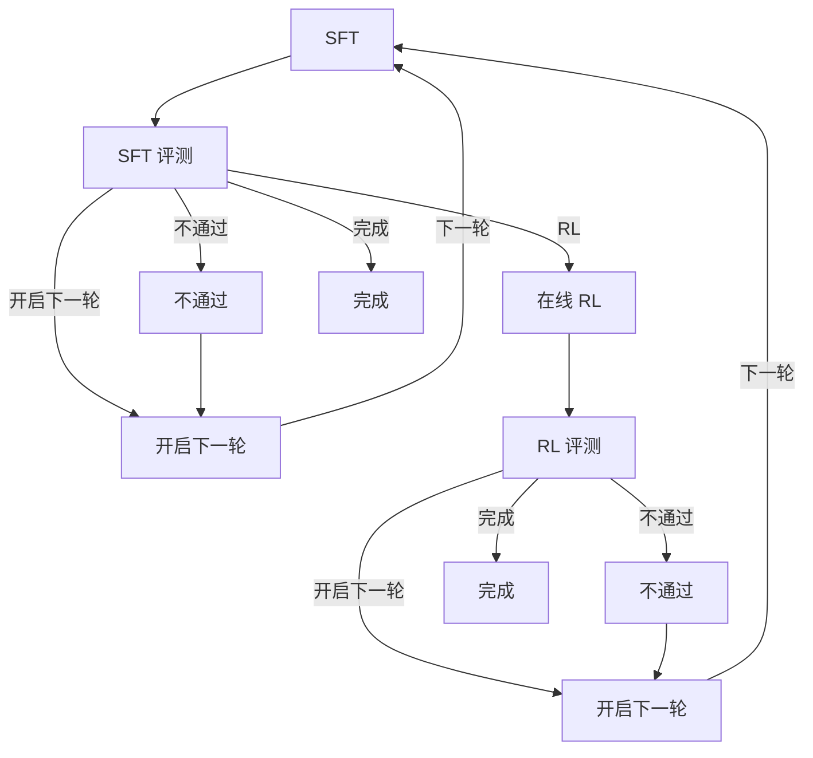

# RSI：基于 ms-swift 的闭环微调工作台

基于开源项目 [ModelScope ms-swift](https://github.com/modelscope/ms-swift)，评测基于 [EvalScope](https://github.com/modelscope/evalscope/blob/main/README_zh.md)，在其上提供可点选的递归自改进闭环：

| 上游 | 链接 |
|------|------|
| ms-swift 仓库 | https://github.com/modelscope/ms-swift |
| ms-swift 文档 | https://swift.readthedocs.io/zh-cn/latest/ |
| EvalScope 仓库 | https://github.com/modelscope/evalscope/blob/main/README_zh.md |
| EvalScope 文档 | https://evalscope.readthedocs.io/zh-cn/latest/ |

**SFT → SFT 评测**。数据集设置在 SFT 阶段。SFT 评测通过后可进入在线 RL、开启下一轮，或完成实验；不通过则只能开启下一轮。RL 评测通过后可完成或开启下一轮；不通过只能开启下一轮。「完成」会把实验标为已结束，但不会锁死「开启下一轮」：仍可挑选检查点再开一轮。没有单独的全局停止动作。

界面为中文。参数名与现有 Gradio Web-UI 以及 `swift sft` / `swift rlhf` / `swift eval` / `swift deploy` CLI 对齐。不修改 ms-swift 本体；仅在你点击运行时通过子进程调用它。

默认模式在 GPU 0 上调用**本仓库检出的 ms-swift**（`python -m swift.cli.main`）：`swift sft`、`swift eval`、`swift rlhf`、`swift deploy`。评测前会把内置 IT 留出 jsonl 转成 EvalScope 的 `general_qa` 目录。需要不加载权重的确定性点通时，设 `RSI_BACKEND=mock`。

更完整的用户操作说明与内部运维见 [`docs/rsi/`](../docs/rsi/)。



这是当前后训练栈里常见闭环的手工版：监督微调定场景行为，留出评测当闸门，在线 RL（此处为 GRPO，ms-swift 默认）用奖励推策略，只有晋级的检查点成为下一轮起点。InstructGPT 走的是 SFT → 奖励模型 → PPO；开源配方更常跳过学好的奖励模型，直接给 completion 打分（GRPO / RLOO / DAPO）。人仍守在闸门上：每一阶段都是表单，晋级是显式选择。

## 本地运行（mock）

在仓库根目录：

```bash
pip install -r rsi/requirements.txt
./run.sh
```

不带参数的 `./run.sh` 等于重启界面。Linux 上若存在 `rsi/configs/fetch.yaml`，会激活其中的 `conda_env`（`model-train`），并用 `train_python` 启动 RSI，从而 Gradio 来自 conda 环境而非 `rsi/.venv`。`RSI_CONDA_ENV` 可覆盖环境名；设为空字符串则跳过激活。`RSI_TRAIN_PYTHON` 可覆盖解释器。macOS 仍用 `rsi/.venv`。`./run.sh start` / `stop` / `restart` 含义如字面。进程号在 `rsi/.rsi.pid`，进程日志在 `rsi/.rsi.log`（每次 `start` 成功前会删掉重建；含启动与 hope clone）。每个实验自己的训练/评测日志在 `RSI_HOME/runs/<run_id>/round_<n>/<stage>/swift.log`（评测在该阶段下的 `eval_output/swift.log`；部署用 `serve/deploy.log`）。进程日志里通常只有一行指针指向上述文件。需要前台跑服务时仍可用 `python -m rsi`。

服务默认监听 `0.0.0.0:8418`。当前内网 GPU 机：[http://10.164.162.4:8418/](http://10.164.162.4:8418/)（仅部署在这一台）。本机调试可打开 http://127.0.0.1:8418

然后：

1. **新建实验**。默认底座为 `Qwen/Qwen2.5-7B-Instruct`，场景为内部 IT 工单。此处选定的 `--model`、`--model_type`、`--template` 之后锁定，含 RL。
2. **SFT**。第一阶段。单卡时表单隐藏 DeepSpeed、DDP、序列并行，并隐藏未选中的 tuner 页签。**数据集设置**：数据来源为公开数据集 / 上传文件 / 服务器本地路径，以及数据集名称（`--dataset`）、验证集拆分比例、句子最大长度、无填充批处理。数据集名称初始为空；未选就跑 SFT/RL 会提示「请先选择数据集」。公开数据集名单与 Web-UI 的 ModelScope 列表一致。各阶段表单改动（多选、滑条、勾选、更多参数、预设重置）会按实验+轮次+阶段存草稿，刷新后仍在，不必先点运行。`--model` / `--model_type` / `--template` 保持锁定。SFT 评测与 RL 评测仍从内置 `itops-heldout` 起步（该留出集是本闭环的闸门；Web-UI 评测下拉本身无默认）。其余字段对齐 Web-UI「LLM预训练/微调」（`swift sft`、LoRA、bf16）。先点「校验格式」，再「运行本阶段」。SFT / SFT 评测 / RL / RL 评测在「运行中」时表单显示「停止」：向该阶段进程组发信号，并把该步记为失败以便重试；其它状态（含「同步中」）不显示。推理服务、模型导出仍用各自的「停止推理」「停止导出」。服务器路径可填 `rsi/examples/itops_mix.jsonl`。日志会打出真实训练将执行的命令；mock 会写 `checkpoint-final/args.json`。
3. **SFT 评测**、**RL**（`swift rlhf --rlhf_type grpo`，vLLM colocate）、**RL 评测**。RL 对齐「LLM GRPO」，两个评测对齐「LLM评测」。SFT 评测在检查点为 LoRA 时会填入 `--adapters`。RL 与两侧评测的 `--model` 仍是实验底座。
4. **开启下一轮**。进入一个面板：从实验底座 / 本轮 SFT / 本轮 RL 中选一个起点权重（mock 准确率更高时推荐 RL），可选沿用上一轮数据，再点「开启下一轮」。该路径成为下一轮起始 adapters（底座 `--model` 不变），界面回到 SFT。历史轮次留在实验记录。晋级成功后，本轮的决定条（RL / 开启下一轮 / 完成）收起。晋级面板随后提供「前往第 N 轮」（主按钮）与「再次开启下一轮」（重跑；会作废后续工作并重新晋级）。
5. **推理服务**。字段、顺序与中文标签对齐 SWIFT Web-UI「LLM推理」（`swift/ui/llm_infer`）。`--model`、`--model_type`、`--template`、`--adapters` 按本轮填好并锁定。部署仍走 RSI 服务管理（`swift deploy --model --adapters`）。起来后可在页内对流式对话到 OpenAI 兼容接口。mock 不加载权重。「更多参数」写在该实验的部署记录里；部署不会清空，再次打开仍显示。其它实验未填则为空。「运行中部署」在部署返回后列出本实验服务；「找回部署」重载同一列表。服务在跑时「日志输出」自动刷新。红色按钮是「停止推理」。本页没有 Web-UI 的「展示部署状态」/「停止展示」。
6. **模型导出**。在推理服务旁，对齐 Web-UI「LLM导出」（`swift export`）。`--model` / `--model_type` / `--template` 仍属实验；`--adapters` 默认填本轮 RL（若有）否则 SFT，可改。「预览命令」看命令；「开始导出」后运行时日志跟上。结束后保留「最近一次导出」状态卡（成功/失败、exit code、`output_dir`、时间、失败时错误片段）及本轮若干导出路径。「用该模型部署推理」跳到推理服务，把 `--model` 设为该 `output_dir` 并清空 adapters。mock 只写日志不加载权重。

重跑已成功的阶段会要求确认。旧审计行保留，本轮后续阶段标为「已作废」。

默认绑定 `0.0.0.0:8418`。端口用 `WEBUI_PORT` 或 `RSI_PORT`，地址用 `WEBUI_SERVER` 或 `RSI_HOST`（例如 `127.0.0.1` 仅本机）。原版 Gradio Web-UI 仍挂在同进程的 `/swift-ui/`（工作台页头不放入口）。Gradio 与 swift 训练栈能 import 时该路径即为原 Web-UI，否则显示无法打开。独立命令 `swift web-ui` 默认同样是 `0.0.0.0:8418`；`WEBUI_PORT`、`WEBUI_SERVER`、`--server_port`、`--server_name` 仍可覆盖。状态（SQLite、上传、检查点）优先 `$RSI_HOME`，否则在可写时用 `fetch.yaml` 的 `rsi_home`，再否则 `rsi/workspace`。GPU 机配置常指向 `/opt/meituan/dolphinfs_liubo108/ms-swift/workspace`。SQLite 写失败时错误里带库路径，把 `RSI_HOME` 指到其它目录即可。

```bash
pytest rsi/tests -q
```

## 数据格式

本地文件按 ms-swift `AutoPreprocessor` 接受的形状校验（见 `docs/source_en/Customization/Custom-dataset.md`）：

- `messages`：`role` / `content`（标准）
- ShareGPT：`conversation` 的 `human` / `assistant`
- Alpaca：`instruction` + `output`
- `query` + `response`

GRPO 可保留 `solution` 或 `answer`（含仅有用户轮的行）。公开数据集 id 在 mock 下只记录不下载；真跑 CLI 时由 ms-swift 解析。上传还支持 `.zip` / `.tar` / `.tar.gz` / `.tgz`：服务端解压到 `$RSI_HOME/uploads/<uuid>/`，把相对的 `images`/`videos`/`audios` 改成绝对路径，训练指向解析后的 jsonl。上传体积不设上限。格式与打包说明见 [`docs/rsi/2026-10-23-user-guide.md`](../docs/rsi/2026-10-23-user-guide.md)「5. 数据格式」。样例：

- `rsi/examples/itops_mix.jsonl` — 6 条 IT 工单，messages + `solution`
- `rsi/examples/itops_eval.jsonl` — 4 条留出工单
- `rsi/examples/itops_reward.py` — GRPO 奖励插件（`itops_checklist`）。mock 不 import；真 `swift rlhf` 经 `--external_plugins` 加载。

## 后端

| 变量 | 默认 | 无 GPU 时 |
| --- | --- | --- |
| `RSI_BACKEND` | `swift` | `mock` |
| `RSI_SERVE_BACKEND` | 与 `RSI_BACKEND` 相同 | `mock` 以保留进程内 API |
| `RSI_SWIFT_BIN` | 本仓库的 `python -m swift.cli.main` | 测试用 stub |
| `RSI_TRAIN_PYTHON` | 存在时用 `fetch.yaml` 的 `train_python`，否则当前 Python | 覆盖 yaml 路径 |
| `CUDA_VISIBLE_DEVICES` | `0` | mock 下不用 |

`MsSwiftBackend` 用 `subprocess` 跑记录的命令；swift 非 0 退出则该步失败。训练在 UI 上立即返回，进程退出后才算结束；跑的时候可刷新实验记录。`RSI_SERVE_BACKEND=swift` 时后台起 `swift deploy`。Mock 部署是进程内 OpenAI 兼容服务，供 `pytest` 使用。

训练机按常规安装 ms-swift 与 GPU 栈（本仓库 `pip install -e .`，再加所需 CUDA 扩展）。RSI 应用本身不 `import swift`，因此只有 `rsi/requirements.txt` 的机器也能起 UI。GPU 机上 `fetch.yaml` 的 `train_python` 为 `/usr/local/conda/envs/model-train/bin/python`；文件存在时 SFT、评测、RL 用它。

## 内网部署

`rsi/configs/fetch.yaml` 的 `model_source` 默认是 **hope**。拉取这份代码后不用再设环境变量：训练前会用 hope 把 Hugging Face 模型同步到本地，`--model` 用本地绝对路径。环境变量 `RSI_MODEL_SOURCE` 仍然优先。Mac 上如果要走 ModelScope，启动前设置 `RSI_MODEL_SOURCE=modelscope`。

hope 或 local 下，同步还是「同步中」时不会启动 swift。模型 id 若是 `modelscope/...` 仍会提示不能在当前网络下载（模型从 Hugging Face 拉）。公开数据集里的 ModelScope id 不再提示这句话，而是用 hope 拉到 `data_root`。

hope 模式下可以不装 modelscope 这个 pip 包：`swift/utils/logger.py` 在缺包时退回本地日志，`import swift` 不会因此失败。完整安装 `pip install -e .` 仍会装上 modelscope。

| 变量 | 作用 |
| --- | --- |
| `RSI_MODEL_SOURCE` | 覆盖 fetch.yaml。可选 `hope`（配置文件里的默认）、`hf`、`modelscope`、`local` |
| `RSI_MODEL_ROOT` | 模型目录，对应 `fetch.yaml` 的 `model_root`。`~` 和 `$HOME` 会展开。`hope clone` 的工作目录就是这一层，仓库落在 `<根>/<org>/<name>` |
| `RSI_DATA_ROOT` | 数据集目录，对应 `data_root`，同样展开 `~` / `$HOME`。`hope clone` 的工作目录是这一层 |
| `RSI_HOPE_USERNAME` / `RSI_HOPE_TOKEN` | 用户名同时用于 `hope login <misid>` 和 `hope clone --username=`。token 只作为 `hope clone` 的 git token（`--token=`），不是平台登录。token 不要写进 yaml |
| `RSI_FETCH_CONFIG` | 另选一份 yaml，键与 `fetch.yaml` 相同 |
| `RSI_CONDA_ENV` | Linux 上覆盖 `fetch.yaml` 的 `conda_env`。设为空字符串则不执行 `conda activate`。macOS 忽略 |
| `RSI_TRAIN_PYTHON` | 覆盖 `fetch.yaml` 的 `train_python`。`RSI_SWIFT_BIN` 则换掉整个启动命令 |
| `RSI_HOME` | 覆盖 `fetch.yaml` 的 `rsi_home`。实验库、运行日志、上传都在这里 |

`fetch.yaml` 示例：

```yaml
model_source: hope
hope_username: liyuhao03
model_root: /opt/meituan/dolphinfs_liubo108/ms-swift/models
data_root: /opt/meituan/dolphinfs_liubo108/ms-swift/datasets
conda_env: model-train
train_python: /usr/local/conda/envs/model-train/bin/python
rsi_home: /opt/meituan/dolphinfs_liubo108/ms-swift/workspace
```

仓库里的 `fetch.yaml` 就是这样写的：模型落在 `/opt/meituan/dolphinfs_liubo108/ms-swift/models`，数据集落在 `/opt/meituan/dolphinfs_liubo108/ms-swift/datasets`（目录不存在时会自动创建，需要当前用户有写权限）。也可以改成 `~/models` 这类路径，`~` 会展开成当前用户的家目录。拉取模型时先进入 `model_root`，再执行 `hope clone https://huggingface.co/<org>/<name>`。hope 3.6.6 把文件放在 `<model_root>/huggingface.co/<org>/<name>`（`rsi/.rsi.log` 里的「数据存储在」就是这个目录）。旧布局 `<model_root>/<org>/<name>` 也算就绪。两边都看 `config.json`，页面上的本地路径和训练的 `--model` 用实际有文件的那一个。Hugging Face 数据集先进入 `data_root`，再执行 `hope clone https://huggingface.co/datasets/<org>/<name>`，文件在 `<data_root>/huggingface.co/datasets/<org>/<name>`，旧布局 `<data_root>/<org>/<name>` 也算就绪。ModelScope 公开数据集（例如 `AI-ModelScope/alpaca-gpt4-data-zh`，以及 Web-UI 那份 `ms_dataset_id` 列表）同样先进入 `data_root`（`fetch.yaml` 的 `data_root`，默认 `/opt/meituan/dolphinfs_liubo108/ms-swift/datasets`），再执行 `hope clone https://www.modelscope.cn/datasets/<org>/<name>.git`。hope 按网址的主机和路径落盘，并去掉末尾的 `.git`，所以目录是 `<data_root>/www.modelscope.cn/datasets/<org>/<name>`。若目录名保留了 `.git`，那个路径也算就绪。数据集目录里要有数据文件（jsonl、parquet 等，或除 `.git` 以外的子目录）才算就绪。这些目录里已经有文件时，打开页面或进入阶段不会再执行 `hope login` 或 `hope clone`。只有点「重新拉取」，或本地还没有这份数据时，才会先走和模型相同的 `hope login`，再 `hope clone`。多选的每个 id 各自判断。上传文件和服务器本地路径不走 hope。

实验目录（`rsi.sqlite`、每次运行的日志和检查点、上传文件）默认用 `fetch.yaml` 的 `rsi_home`：`/opt/meituan/dolphinfs_liubo108/ms-swift/workspace`。环境变量 `RSI_HOME` 优先。这个目录不存在、并且上一级也不存在或不可写时（Mac 上没有 dolphinfs），改用仓库里的 `rsi/workspace`，不会去创建 `/opt/meituan/...`。实验记录库写失败时，接口返回的中文错误里带数据库绝对路径，这时把 `RSI_HOME` 指到别的可写目录即可。

内置训练集是仓库里的 `rsi/examples/itops_mix.jsonl`（6 条 IT 工单）。训练命令里的绝对路径是当前机器上这份检出的路径，不是另一台电脑的家目录。例如 GPU 上会写成 `/home/hadoop-sailorqa-ai/ms-swift/rsi/examples/itops_mix.jsonl`，文件就在该仓库的 `rsi/examples/` 下。

在 Linux 上，`./run.sh` 用 `fetch.yaml` 的 `train_python`（`/usr/local/conda/envs/model-train/bin/python`）启动 RSI 本身，并先 `conda activate model-train`。这个文件存在时不会改用 `rsi/.venv`。文件不存在时日志会写明路径，再退回 `.venv`。`RSI_TRAIN_PYTHON` 覆盖解释器。`RSI_CONDA_ENV` 换环境名；设为空字符串则不激活。macOS 仍用 `rsi/.venv`。

SFT、评测和 RL 也不用界面那个精简 `rsi/.venv`。同一个 `train_python` 存在且可执行时，swift 用它启动。当前机器没有这个路径时会跳过，仍用启动界面的那个 Python。`RSI_SWIFT_BIN` 换掉整个启动命令。

「模型导出」在「推理服务」旁边，字段和分组跟 Web-UI「LLM导出」一致。`--model`、`--model_type`、`--template` 仍是新建实验时的值，不能改。`--adapters` 默认填本轮最新的 RL 或 SFT 权重，可以改。点「预览命令」看 `swift export`，点「开始导出」后「运行时」里的日志会跟上。没有单独的「展示导出状态」按钮，日志在任务进行时自动刷新，红色按钮是「停止导出」。

推理服务页和 SWIFT Web-UI 的「LLM推理」是同一套字段、顺序和中文标签（含 `(--参数)` 和说明）。`--model`、`--model_type`、`--template`、`--adapters` 按本轮实验填好并且不能改。部署仍走 RSI 自己的服务管理。起来之后可以在页面里流式对话。「更多参数」写在该实验的部署记录里。点「部署模型」不会清空；再次打开这个实验仍显示上次保存的内容。别的实验没填过就是空的。「运行中部署」在部署返回后列出该实验正在运行的服务；「找回部署」重新加载同一份列表。服务在跑时「日志输出」直接显示并自动刷新。红色按钮是「停止推理」，用来停掉这次部署。页面上没有「展示部署状态」和「停止展示」。

仓库里的 `fetch.yaml` 已写 `hope_username: liyuhao03`。这个 misid 会传给 `hope login`，也会作为 `hope clone` 的 `--username=`。换 misid 改这一行，或用 `RSI_HOPE_USERNAME` 覆盖。token 仍只走 `RSI_HOPE_TOKEN`，只给 `hope clone` 当 git 凭据，不能代替平台登录。

平台登录由 RSI 自己执行，而且只在某次拉取真正要 `hope clone` 之前跑。`./run.sh` 启动进程、依赖检查都不会执行 `hope login`，也不会发大象消息。开始下载时会跑 `hope login liyuhao03`（标准输入关闭，最多等约 90 秒）。hope 会往大象发确认；页面上显示「已向大象发送登录确认，请在大象里确认」。确认后 hope 打印「登录成功」，接着才会 clone。已经登录且本次进程里登录仍有效时，这条命令大约 1 秒返回，随后的 clone 不再重复调用，除非这次 clone 又打出登录认证。同一时间只跑一次登录。失败或超时后几分钟内不会再次发给大象，点「重新拉取」可以马上再发一次。超时或未确认时，拉取状态是「hope 登录未确认：请点重新拉取再发一次，或在终端执行 hope login liyuhao03」。没有配置 misid 时会提示设置 `hope_username`。

hope 本身要事先装好（`./run.sh` 不会安装它）。**本地 Mac（Darwin）默认跳过 hope 检查**，Web-UI 可正常启动；真正做 hope 拉取时若缺 CLI 会在阶段里报错。Linux 训练机上，来源是 hope 但找不到 `hope` 命令时，`./run.sh` 打印下面这一行并立刻以非 0 退出，不会把服务拉起来：

```text
pip3 install hope==3.6.6 --no-cache-dir -i https://pypi.sankuai.com/simple
```

覆盖：`RSI_SKIP_HOPE=1` 在任意平台跳过检查；`RSI_REQUIRE_HOPE=1` 强制检查（含 Mac）。

`./run.sh` 把本进程的标准输出写进 `rsi/.rsi.log`（每次 `start` 成功启动前会删掉重建）。页面上没有「进程日志」。`hope login` 会把命令、目录、退出码和输出追加进这个文件。`hope clone` 一开始就写命令和目录，随后把 stdout/stderr 原样追加（不等进程结束，用户名和 token 会抹掉），结束时再写退出码。hope 的标准输入是关闭的，不会停在密码提示上。某阶段触发的拉取会把同一份已抹掉密钥的输出再追加到该阶段的 `swift.log`，进程日志仍然保留。

训练、评测的完整输出按实验分开，不进 `rsi/.rsi.log`。路径是 `runs/<实验 id>/round_<轮次>/<阶段>/swift.log`（评测在该阶段下的 `eval_output/swift.log`）。进程日志里只多一行指针，例如 `[sft <实验 id>] 实验日志：<上面的路径>`。这个阶段正在拉取时，hope 的登录和 clone 进度会先写进同一个 `swift.log`，多选时每份仓库单独一行 `[数据集]` 或 `[模型]`。hope 的标准输出走管道，再追加进这个文件；不会把阶段日志交给 hope 重定向，所以后一次 clone 不会把前面的登录和进度清掉。回车刷新的下载进度也不会抹掉上一行。多份数据和模型都落盘后，这一阶段会自己开训，不用再点一次。拉取失败则阶段记为失败。swift 的输出接在后面，不会盖掉前面的进度。页面上该阶段的「日志」在「同步中」和「运行中」都会跟着这个文件刷新，状态从同步变成运行时会重新载入，可以全屏。SFT、SFT 评测、RL、RL 评测在「运行中」时，表单上有红色「停止」：停掉这一阶段的进程组，并把该步记为失败，之后可以重试。其它状态（含「同步中」）不显示这个按钮。推理和导出仍用各自的「停止推理」「停止导出」。推理部署的输出是 `serve/deploy.log`。服务在跑时，「推理服务」的「运行时」会直接显示「日志输出」并自动刷新。停止按钮是「停止推理」。

`hope --version` 应为 3.6.6。同步是异步的。页面上的拉取状态只看本地文件：目录里出现 `config.json`（数据集则是数据文件）后才是「就绪」，在这之前阶段日志里能看到进度，`rsi/.rsi.log` 里也有一份。不会调用 `hope list`。训练命令的 `--model` 改为本地路径，并带上 `--model_type` 和 `--template`。子进程会设置 `HF_HUB_OFFLINE=1`、`TRANSFORMERS_OFFLINE=1`、`HF_DATASETS_OFFLINE=1`。

公开数据集在 hope 下会先 clone 到 `data_root`，SFT 的 `--dataset` 用那个本地目录。ModelScope id 用 `https://www.modelscope.cn/datasets/<org>/<name>.git`，Hugging Face 的 `org/name` 仍用 `huggingface.co/datasets`。上传文件和服务器本地路径不走 hope。模型 id 若是 `modelscope/...` 仍提示不能在当前网络下载。内置评测 jsonl 仍走本地 `general_qa`。其它评测集放到 `$RSI_DATA_ROOT/benchmarks/<名字>`，或在 `eval_dataset_args` 里写 `local_path`。

在 Mac 的这份仓库里，把分支 `cursor/rsi-diag-card-ui-20261019-4ed3` 同步到内网：

```bash
rsi/scripts/sync-to-sankuai.sh
```

脚本从自己所在的仓库找根目录。工作区有未提交改动会直接退出。然后从 GitHub `origin` 快进拉取该分支。若 `sankuai`（`ssh://git@git.sankuai.com/~liyuhao03/ms-swift.git`，没有这个远程时会加上）有当前分支没有的提交，按从旧到新 cherry-pick，先推 GitHub，再推 sankuai。cherry-pick 会换成新哈希，推 sankuai 可能不是快进；默认不强推，打印原因后以非 0 退出。确认覆盖内网分支时再执行 `rsi/scripts/sync-to-sankuai.sh --force-sankuai`（只对 sankuai 使用 `--force-with-lease`）。

## 硬件预设

面向 **1× NVIDIA A100 80GB**、约 18 核 CPU、约 92GB 内存（可用约 60GB）。

`rsi/configs/a100_80g.yaml` 里的数字即表单默认：

- **7B LoRA bf16**：能同时塞下 SFT 与 GRPO 的主路径。SFT：batch 1、梯度累积 16、最大长度 2048、梯度检查点、`attn_impl=sdpa`（装了 flash-attn 可改 `flash_attention_2`）。
- **不要在这台机器上全量微调 7B**。Adam 优化器状态塞不进约 60GB 可用内存。保持 `tuner_type=lora`。
- **14B** 可试 QLoRA（`quant_method=bnb`，`quant_bits=4`）做 SFT。14B 上 GRPO + 同卡 vLLM 很紧，先降 `max_completion_length` 和 `num_generations`。
- **32B 在线 RL 单卡 80GB 放不下**。
- GRPO 用 **vLLM colocate**，rollout 与训练共用唯一 GPU：`vllm_gpu_memory_utilization=0.45`、`sleep_level=1`、`offload_model`、`offload_optimizer`、`num_generations=4`、tensor parallel 1。独立 server 模式的 vLLM 需要第二张卡，本预设不用。
- **单卡不传 DeepSpeed / DDP / 序列并行。** 选满两张 GPU 前 SFT/RL 隐藏这些控件。`--deepspeed`（含 `zero0`）开训前会检查是否安装 `deepspeed`。AdaLoRA、VeRA、ReFT、BOFT、FourierFT、LISA 与 embedding loss 页签仅在选中对应方法时显示，否则不写进命令。
- `dataset_num_proc=8`、`dataloader_num_workers=4`，给 18 核机器上的 vLLM 留核。
- 晋级后的部署用 `infer_backend=vllm`，训练已结束时可占大部分 GPU（`vllm_gpu_memory_utilization=0.9`）。

其它 swift 标志可在各阶段「更多参数」YAML 框追加；同名键会覆盖表单。

## 审计

SQLite 表 `runs`、`rounds`、`steps`、`checkpoints`、`services` 记录每次实验与每一步：状态、参数、结果、日志、swift 命令、`started_at`、`ended_at`。「实验记录」页可看，含已作废尝试。库文件为 `$RSI_HOME/rsi.sqlite`（默认 `rsi/workspace/rsi.sqlite`）。该目录需本地可写；dolphinfs / NFS 家目录往往建不了 SQLite journal，读得过、写会失败。

## 目录结构

```
rsi/app.py            FastAPI + 静态 UI
rsi/pipeline.py       阶段顺序与晋级
rsi/backends.py       MockBackend、MsSwiftBackend
rsi/model_fetch.py    跑 swift 前的可选本地拉取
rsi/serving.py        mock OpenAI 服务
rsi/schemas.py        从表单对齐 Web-UI 参数名
rsi/configs/a100_80g.yaml
rsi/examples/         内置数据与 GRPO 奖励插件
rsi/tests/            数据集校验与 mock 端到端闭环
```
